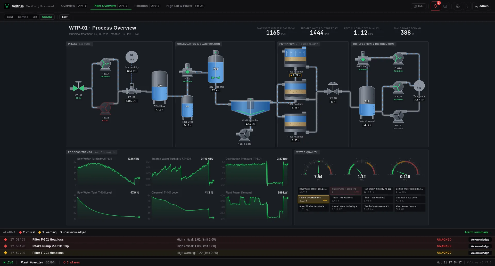

# Voltrus SCADA

Self-hosted SCADA and industrial monitoring in a single Rust binary, with a
React web client. Poll PLCs and meters, keep the history in SQLite, build
dashboards and run alarms, on your own hardware and with no cloud account.

This repository is the open-source **Core**, licensed under
[AGPL-3.0-or-later](LICENSE). A separate **Enterprise add-on** (single sign-on,
21 CFR Part 11, hot standby and more) is sold per site. Its source is available
to read in
[VoltrusID/voltrus-scada-enterprise](https://github.com/VoltrusID/voltrus-scada-enterprise)
under the Voltrus Enterprise License, which is not an open-source licence.
See [Core vs Enterprise](#core-vs-enterprise).

Built by [JoyoDigitama](https://joyodigitama.com).

[Download](https://voltrus.id/voltrus-scada/#download) ·
[Quick start](#quick-start) ·
[Docs](https://voltrus.id/voltrus-scada/docs/) ·
[Pricing](https://voltrus.id/voltrus-scada/#pricing) ·
[Compare with Ignition, AVEVA and FUXA](https://voltrus.id/compare/) ·
[Help with a site deployment](mailto:support@voltrus.id?subject=Voltrus%20SCADA%20site)

**Live demo:** <https://demo.voltrus.id>, a simulated water treatment plant
running Core. Sign in as `guest` / `voltrus-demo` (read-only).

[](https://demo.voltrus.id)

**What is free and what is paid.** Core (this repository) is free, also for
commercial use, with every protocol and no device, tag or retention limits.
Two optional licences are sold per site: **Integrator** ($249 lifetime or
$19 a month: white-label, PDF reports, Telegram and WhatsApp alarms,
multi-site hub) and **Enterprise** ($999 lifetime or $79 a month: adds SSO,
21 CFR Part 11 mode, hot standby). Current prices are on
[voltrus.id](https://voltrus.id/voltrus-scada/#pricing); the split is in
[Core vs Enterprise](#core-vs-enterprise).

### Try it in two minutes

Linux x86_64 (use `aarch64` on a Raspberry Pi; Windows and macOS builds are
on the [releases page](https://github.com/VoltrusID/voltrus-scada/releases/latest)):

```bash
V=v0.52.0
curl -L https://github.com/VoltrusID/voltrus-scada/releases/download/$V/voltrus-core-$V-linux-x86_64.tar.gz | tar xz
cd voltrus-core-$V-linux-x86_64 && cp config.yaml.example config.yaml
./modbus-sim &          # a simulated Schneider PM5560 power meter on port 5020
./voltrus config.yaml   # open http://localhost:3000
```

Sign in as `admin` with the password in `./initial-admin-password`, then add
a Modbus device at `127.0.0.1`, port 5020, with the built-in PM5560 template.
The full [Quick start](#quick-start) covers Windows, services and building
from source.

## Core features

* **Protocols:** Modbus TCP, OPC UA, Siemens S7, EtherNet/IP (CIP), DNP3,
  BACnet/IP, and an embedded MQTT broker. SNMP network scan for asset discovery.
  Device templates for Modbus and BACnet: built-in, saved from your own
  devices, or imported from a public catalog.
  Each protocol is a Cargo feature, all on by default. The drivers are not
  equally mature; see [Project status](#project-status).
* **Dashboards:** responsive grid, free-form canvas, 3D digital twin and a 2D
  SCADA diagram editor, with per-screen layouts.
* **Alarms:** warning and critical thresholds (zero and negative limits too),
  priorities, shelving, deadband, on and off delay, acknowledgement, alarm
  analytics, email, webhook and push notifications. Alarms are evaluated only
  on values of good quality.
* **Historian:** a sample of every tag each persistence interval
  (`persist_interval_secs`, default 5 s) packed into compressed blocks
  (delta-of-delta timestamps, XOR floats, run-length digitals), per-tag
  deadband, hourly and daily tiers with automatic downsampling and CSV archive,
  trends, SPC charts, annotations, CSV and Excel import and export. See
  [docs/historian.md](docs/historian.md).
* **Automation:** flows drawn as graphs (branching on switch and filter
  ports, delay, rate limit, on-change, notify, debug nodes) started by tag
  changes, alarms, cron schedules, webhooks, device polls, MQTT or the run
  button, with dry-run testing and a per-node run trace
  ([docs/flows.md](docs/flows.md)); JavaScript scripts (QuickJS), recipes,
  a command queue with retries, expiry and write read-back, simulation mode.
* **API:** REST with an OpenAPI document and an interactive API reference at
  `/api/docs` (sign in first), live data over WebSocket (MessagePack) with a
  server-sent-events fallback at `/api/v1/stream`, plus TypeScript and Python
  SDKs in [`sdks/`](sdks) (MIT licensed; they cover the main endpoints and
  can lag the server version). Tag writes from REST, WebSocket and MCP go
  through the same command queue, write policy and audit trail
  ([docs/live-stream.md](docs/live-stream.md)), and so do flow `WriteOut`
  nodes and recipes. Every live value carries a quality (good, uncertain,
  stale, bad) and a millisecond timestamp. API keys go in the `X-API-Key`
  header; `?api_key=` is accepted only on `/metrics` (Prometheus) and
  `/api/v1/stream`.
* **AI agents (MCP):** a Model Context Protocol server built into the server at
  `/mcp`, so Claude and other MCP clients can read values, manage devices and
  tags, and acknowledge alarms with an API key. Writes and deletions need a
  second confirming call by default, calls are rate limited per key, and
  `mcp.read_only: true` turns every write tool off. See
  [docs/mcp.md](docs/mcp.md).
* **AI copilot (optional):** drafts register maps, dashboards, alarm
  thresholds and flows for an engineer to review. Bring your own provider:
  OpenAI, Anthropic, or any OpenAI-compatible server at a base URL you set
  (Ollama, LM Studio, OpenRouter, Gemini, DeepSeek, Groq, your own gateway).
  With Ollama or LM Studio on your network it works offline and needs no key.
  Admins set it up in the copilot's Settings tab.
* **Operations:** OEE and downtime, shift handover, asset inventory with NIS2
  export, config snapshots, backup and restore, whole-configuration YAML
  projects (`voltrus project export|import|validate`).
* **Security:** local accounts with Argon2 and four roles: `admin`
  (everything), `demo` (operate and configure), `operator` (operate the plant:
  write tags within their write policy, acknowledge and shelve alarms, load
  recipes, start and stop flows; no configuration) and `viewer` (read only);
  accounts can be disabled (signed out at once, sign-in refused, history
  kept) from Data Manager › Admin › Users; API keys whose permissions can narrow, never widen, their role; rate
  limiting, SameSite=Strict session cookies, security headers, intrusion
  detection; a hash-chained audit log (`GET /api/v1/audit/verify`) that
  records the old and new value of every setpoint change; the AI provider key
  encrypted at rest. Custom roles are labels only for now. Add-on editions can
  add password policy, session timeouts and electronic signatures through
  [edition hooks](docs/edition-hooks.md).
* **No limits and no licence key:** unlimited devices, tags and retention.

## Project status

Voltrus is young and built by a small team. Not every part is at the same
level, and this table says where each one stands so you can plan around it.

| Area | Status |
|---|---|
| Modbus TCP | Production: batched reads, timeouts, reconnect with backoff; queued writes in the register's type, scale, area and word order, coils included |
| OPC UA | Reads through subscriptions; writes through the live session in the node's data type. Secure modes need the server certificate in `pki/trusted` |
| Siemens S7 | Reads split to the negotiated PDU size; writes in the tag's type (BOOL to REAL, INT/DINT). Tested against the bundled simulator, not yet a real PLC |
| EtherNet/IP | Reads and writes in the tag's CIP type (BOOL to LREAL), 5 s timeouts. Unconnected messaging only; not yet tested on a real controller |
| DNP3 | Beta: own IEEE 1815 master (integrity and event polls, unsolicited responses, select-before-operate and direct operate, time sync). Tested only against the bundled outstation simulator |
| BACnet/IP | Experimental: ReadPropertyMultiple polling; WriteProperty in the object's type with priority (default 8). No COV or segmentation yet |
| Device start-up | Every enabled device starts polling at boot |
| Command queue | Retries with backoff; a write not delivered within 30 minutes expires instead of landing late; acknowledged writes are verified by read-back (confirmed, mismatch or timeout) |
| Data quality | Every value is good, uncertain, stale or bad (with a reason) and has a millisecond timestamp; bad and stale values stay out of the historian |
| Alarms | Thresholds (zero and negative too), deadband, on/off delay, acknowledgement and shelving, evaluated on good values only. Not the full ISA-18.2 state model yet |
| Native console ([`native/`](native/README-native.md)) | Experimental, macOS first |

Help with any of these is welcome; see [Contributing](#contributing).

## Core vs Enterprise

Core is complete for one site. The Enterprise add-on is unlocked per site by a
licence key; a lapsed or missing key never limits Core.

| | Core (this repo) | Integrator | Enterprise |
|---|:-:|:-:|:-:|
| Everything listed above, all protocols, no limits | yes | yes | yes |
| White-label branding and theme editor | | yes | yes |
| Scheduled PDF reports and Telegram/WhatsApp alarms | | yes | yes |
| Multi-site hub | | yes | yes |
| Single sign-on (AD, Azure AD, Okta, SAML, OIDC, LDAP) | | | yes |
| 21 CFR Part 11 mode (e-signatures, record checksums) | | | yes |
| IEC 62443 security audit mode | | | yes |
| Hot standby with automatic failover | | | yes |
| RTSP video cameras | | | yes |
| Support | community | standard | priority SLA |

Integrator and Enterprise are sold as a lifetime licence or monthly, per site. A per-site key can also carry an annual support contract; a lapsed contract never limits Core or anything already licensed.

Services, for any edition including Core: remote commissioning at $490 per
site (Modbus TCP or OPC UA, up to 2 devices, 300 tags and 50 alarms, one
dashboard), Site Support at $390 per site per year (first reply within 2
business days, 2 hours of remote troubleshooting), or both with an Integrator
lifetime licence as Site Starter for $990. Send the scope to
[support@voltrus.id](mailto:support@voltrus.id?subject=Voltrus%20SCADA%20services)
and we invoice it. On-site work in Indonesia is quoted per job.
Current prices: <https://voltrus.id/voltrus-scada>. Official Voltrus binaries
are Core plus the add-on. Details of the split and how it is built:
[docs/open-core.md](docs/open-core.md).

## Quick start

### Run a prebuilt binary

Prebuilt Core binaries for Linux (x86_64, aarch64 for a Raspberry Pi), Windows
(x86_64) and macOS are attached to each
[release](https://github.com/VoltrusID/voltrus-scada/releases/latest). The web
client is inside the executable. On Linux x86_64 (use the file name of the
latest release, and `aarch64` on a Pi):

```bash
V=v0.52.0
curl -LO https://github.com/VoltrusID/voltrus-scada/releases/download/$V/voltrus-core-$V-linux-x86_64.tar.gz
tar xzf voltrus-core-$V-linux-x86_64.tar.gz && cd voltrus-core-$V-linux-x86_64
cp config.yaml.example config.yaml   # set auth_secret and your devices
./voltrus config.yaml                # then open http://localhost:3000
```

On Windows, unzip the archive and run `voltrus.exe config.yaml`, or run
`voltrus-scada-$V-windows-x86_64-setup.exe`, which installs the server as a
service and the native console as one station (see "Local station" below).
The installer is not code-signed, so Windows SmartScreen warns before it
runs: choose **More info**, then **Run anyway**. The Linux
archive also has `modbus-sim`, a simulated power meter on port 5020, and a
`voltrus.service` unit for systemd. Sign-in and the first admin password are
described below under "Open http://localhost:3000".

### Build from source

You need Rust (stable, edition 2024) and Node.js 22.12 or newer (the client's
Vite needs it).

```bash
# 1. Build the web client into ./static
cd client && npm ci && npm run build && cd ..

# 2. Build the server (all protocols and scripts). A release build embeds ./static
#    into the executable, so step 1 has to come first.
cargo build --release

# 3. Edit config.yaml (devices, auth_secret), then run
./target/release/voltrus config.yaml
```

The release binary is one file: the web UI is inside it, compressed, and served
with content types, ETags and long-lived caching for the hashed assets, and with
the page as the answer to client-side routes. It needs only a config file (and
creates its database on first start).

* **Build order.** `cargo build --release` fails with a message when
  `static/index.html` does not exist. To build without the web UI (an API-only
  server, simulators, CI jobs that never open the UI) set
  `VOLTRUS_SKIP_UI_EMBED=1`. Debug builds (`cargo build`, `cargo test`,
  `cargo clippy`) embed nothing and need no client build; `VOLTRUS_EMBED_UI=1`
  embeds the UI in a debug build too.
* **Precedence.** If `static/index.html` exists in the working directory, that
  folder is served instead of the built-in UI, whole. That is for a patched or
  themed UI, or for `npm run build` against a running server. The log says which
  UI is served at startup. A `static/` folder left over from an older release
  therefore shows the old UI: delete it after upgrading to use the built-in one.
  Started from the repository, as above, the server serves the `static/`
  folder from step 1 and logs a warning about it. That is expected.

If you serve Voltrus over plain HTTP on the LAN (`http://<ip>:3000`) the sign-in
cookie is set without the `Secure` attribute, so login works. Behind an HTTPS
reverse proxy or tunnel on the same machine that sends `X-Forwarded-Proto: https`
(or Cloudflare's `CF-Visitor`) it is set with `Secure`. `cookie_secure: true` or
`false` in the config forces either; the default is `auto`.

For a public demo with one shared read-only login, create a `viewer` account and
set `shared_accounts: [guest]` and `login_hint: "Demo: sign in as guest / ..."`:
the hint appears under the sign-in form, and visitors can neither change that
account's password or preferences nor lock it with wrong passwords. Also set
`outbound_http: {allow_private_networks: false}` there (see Network behaviour).

Behind a reverse proxy or tunnel on the same machine, login limits and the audit
trail see each client's address from `X-Forwarded-For`, read from the right, as
long as the proxy appends to it (nginx `$proxy_add_x_forwarded_for`; Caddy and
cloudflared do). For a proxy on another machine, or one that only sets
`X-Real-IP` or `CF-Connecting-IP`, set `trusted_proxy` (see
[`config.yaml`](config.yaml)).

Open <http://localhost:3000>. The first start generates a random admin
password and writes it to `initial-admin-password` next to the database
(readable by the owner only); the log shows the path, never the password.
With `db_path: "data.db"` that is `./initial-admin-password` in the folder you
started the server from. Sign in as `admin` with it; you must then choose a new
password, which deletes the file. Release binaries up to v0.50.1 print the
password in the log instead and write no file.

Set `auth_secret` in the config. Without it a new secret is generated at every
start, which signs everyone out and makes a stored AI provider key unreadable.

To build with fewer protocols:

```bash
cargo build --release --no-default-features --features "modbus,opcua,mqtt-broker"
```

### Configuration

One YAML file. A minimal example:

```yaml
server_port: 3000
db_path: "data.db"
persist_interval_secs: 5
# auth_secret: <random string, at least 16 characters>

devices:
  - id: "meter_1"
    ip: "192.168.1.10"
    port: 502
    unit_id: 1
    interval_ms: 1000
    registers:
      - name: "voltage"
        address: 40001
        type: "float32"
```

[`config.yaml`](config.yaml) lists more options (retention tiers, SMTP, MQTT
broker, networks). Devices can also be managed from the web UI.

Modbus and BACnet devices can also be created from shared device templates,
built in or from a public catalog; see
[docs/device-templates.md](docs/device-templates.md).

### Configuration as code

`voltrus project export ./site` writes the whole configuration (devices of every
protocol, tags with alarm and write policies, screens and layouts, flows,
scripts, recipes, notification rules, ...) as YAML files keyed by names, never
by database ids. `voltrus project import ./site --dry-run` prints what an
import would create, update or delete; without `--dry-run` it applies it in one
transaction (`--mode replace` also deletes what the project does not list).
Secrets are written as `${ENV_NAME}` references. Format and examples:
[`docs/project-format.md`](docs/project-format.md).

### Local station / run as a service

One PC can run the server and the native console together, like a classic HMI
station. The server runs as an OS background service on 127.0.0.1, so closing
the console never stops polling, alarms, history or writes.

```bash
voltrus station init            # config.yaml, data.db, logs/, station.toml
voltrus station init --new-password  # a new password for the station account
voltrus service install         # Windows service / macOS LaunchAgent
voltrus service start
voltrus service status          # exit 0 running, 3 stopped, 4 not installed
```

The station directory is `%ProgramData%\Voltrus SCADA` on Windows,
`~/Library/Application Support/Voltrus SCADA` on macOS and
`~/.local/share/voltrus-scada` elsewhere (override with `--dir` or
`VOLTRUS_STATION_DIR`). `station init` picks a free port from 3000, keeps an
existing config and writes `station.toml`, the credential of the `station`
account the console signs in with (an operator when created, since every
local account that can read the file signs in as it; it keeps any role you
give it later; `admin`'s generated password is in `initial-admin-password`
there, readable by administrators only); run it again to repair it. It also
locks the directory down: private to your account on macOS and Linux; on
Windows (run it as administrator) owned by Administrators, with only SYSTEM and
Administrators allowed in and Users allowed to read `station.toml`. The
service runs `voltrus service run --dir <station dir>` and logs to
`logs/voltrus.log`. On Linux use the systemd unit in
[`deploy/voltrus.service`](deploy/voltrus.service) instead of `voltrus service`.

On Windows the release's `voltrus-scada-<version>-windows-x86_64-setup.exe`
does all of this: it installs the server and the native console, runs
`station init`, `service install` and `service start`, and the console signs
in by itself. It is unsigned (SmartScreen warns, as above). Uninstalling
removes the service and keeps the plant data.

### Simulators and scenarios

`cargo run --features modbus --bin modbus-sim` and the other `*-sim` binaries
start fake devices. `modbus-sim` listens on port 5020: add a Modbus device at
`127.0.0.1`, port 5020, in the web UI to read it.

[`scenarios/`](scenarios) has ready-made plants (solar farm, data centre,
factory floor, oil and gas well, water treatment). To run one with its
simulators and a server on <http://localhost:3000>, after the quick start:

```bash
./run-scenario.sh solar-farm    # needs tmux
tmux kill-session -t voltrus-solar-farm   # stop it
```

The admin password is in `./initial-admin-password`, as above.

## Network behaviour

Core makes no outbound connections on its own. It does not check for updates,
send telemetry or contact any Voltrus server. It only connects to what you
configure: your devices, your SMTP server, your webhooks and MQTT brokers, and
an AI provider if you enable the optional AI copilot with your own key (or a
local model server such as Ollama, which keeps it all on your network).
The API documentation page (`/api/docs`, signed-in users only) loads its viewer
script from a public CDN; the OpenAPI document at `/api/v1/openapi.json` does not.

Requests to URLs that users configure (outbound webhooks and their test button,
alarm webhooks, flow `http_out` nodes) follow no redirects and never go to a
link-local address such as the cloud metadata service (169.254.169.254).
This machine (loopback, and its own LAN and public addresses) is refused unless
`outbound_http.allow_loopback: true`; private networks are allowed unless
`outbound_http.allow_private_networks: false`. Host names are checked after
they resolve, and `HTTP_PROXY`/`HTTPS_PROXY` are not used for these requests.
The webhook test button reports the HTTP status only, not the response body.
The AI copilot's base URL is not restricted (a local model server is the usual
setup); changing it without entering a key again removes the stored key.

Readers who may not configure (viewers, operators, read-only API keys) see
header values and URL passwords of outbound webhooks and flow `http_out` nodes
as `********`; an editor that saves the masked value back keeps the stored one,
as long as the node still posts to the same scheme, host and port (otherwise
the secrets must be entered again). Errors stored for flow runs and webhook
tests name URLs without their password.

## Development

```bash
cargo fmt --all -- --check
cargo clippy -- -D warnings
cargo test          # debug build: no client build needed

cd client
npm ci
npm run dev        # Vite dev server on :5173
npx tsc --noEmit
npm test
```

The server is a library plus the `voltrus` binary in one crate. The
[extension seam](src/edition.rs) is how an add-on edition plugs in.

```
src/            Rust server (api/, storage/, protocol drivers, flow engine, ...)
client/         React web client (src/edition/ is the add-on seam)
sdks/           TypeScript and Python SDKs (MIT)
native/         experimental native operator console (GPUI), see native/README-native.md
scenarios/      simulated plants for testing
deploy/         example systemd unit
docs/           open-core split, MCP server, live stream, upgrade notes
```

## Contributing

Contributions are welcome. Sign off every commit (`git commit -s`) and read
[CONTRIBUTING.md](CONTRIBUTING.md), which explains the DCO and the licence grant
that lets the project keep offering the Enterprise add-on. Report security
problems privately, see [SECURITY.md](SECURITY.md).

## Licence and trademark

Copyright (c) 2026 JoyoDigitama. Licensed under the GNU Affero General Public
License v3.0 or later, see [LICENSE](LICENSE) and [NOTICE](NOTICE). The SDKs in
`sdks/` are MIT licensed. If you run a modified version for others over a
network, AGPL section 13 requires you to offer them the source.

"Voltrus" and the Voltrus logo are trademarks of JoyoDigitama. The AGPL does
not grant trademark rights: forks must use another name, see
[TRADEMARKS.md](TRADEMARKS.md). Product and protocol
names (Modbus, Siemens, Allen-Bradley, BACnet and others) are used only to
describe compatibility and belong to their owners.
