# Voltrus Designer

Design for the browser screen editor that replaces the 2D view's Edit mode:
panes, bindings, a flat ISA-101 library, version history, live collaboration,
mobile layouts and a widget SDK. Phases 1, 2, 3, 4 and 5 are built; phase 2b
(the widget SDK) is a design, grounded in the code as it is on `main` after #29.

Order: **1** editor, **2** symbol library and equipment types, **2b** widget SDK,
**3** version history, **4** collaboration, **5** mobile and PWA. Version history
comes before collaboration because collaboration needs its change log.

## What exists today

A 2D screen is two sets of rows per screen, read and written whole:

| Route | Rows | Storage |
|---|---|---|
| `GET`/`PUT /api/v1/screens/{id}/scada-equipment` | `{equipment_id, equipment_type, equipment_name, x, y, width, height, rotation, sensor_bindings, config}` | `scada_equipment`, replaced per screen in one transaction (`storage/settings_scada.rs`) |
| `GET`/`PUT /api/v1/screens/{id}/scada-connections` | `{connection_id, from_equipment, to_equipment, connection_type, waypoints}` | `scada_connections` |
| `GET`/`PUT /api/v1/screens/{id}/scada-layout` | both sets plus a `revision`; the `PUT` takes `base_revision` and answers 409 when the screen changed since | both tables in one transaction (added with the Designer) |
| `GET`/`POST /api/v1/faceplates`, `.../{id}` | faceplate definitions with roles | `faceplates` |

`config` and `sensor_bindings` are JSON text. The client turns rows into a
`ScadaLayoutState` (`client/src/scada2/engine/layout.ts`); stacking order travels
in `config.z`. A screen's **revision** is the SHA-256 of its equipment and
connection rows (sorted by id), computed under the same lock as writes; it is
not stored, so any writer (old editor, MCP, import) changes it. Load-then-save gives identical rows (`client/tests/scadaRoundTrip.test.ts`,
`api::tests::screen_round_trip`, `api::tests::mcp`). Projects carry screens as
`screens[].scada` with tags named by ref (`device/key`); `config.faceplateMap` is
translated id↔ref on export and import (`project_yaml/export.rs`, `import.rs`).

The editor before the Designer: `client/src/scada2/ScadaView.tsx` (run mode and
an Edit mode in one component), a palette, an inspector, react-rnd per widget,
undo/redo over whole layouts. It stays reachable (the 2D view's **Edit** button)
until the Designer is accepted.

## Phase 1: the editor (built)

Open it from the 2D view (**Designer**, admins and engineers) or at
`/designer?screen=<id>`. It is a full-window overlay of the app, so it shares the
session, live data store, theme, toasts, trend popup and signature dialog.

```
┌ title: screen · unsaved dot · Design | Preview · theme · close ───────────────┐
├ toolbar: save undo redo · select connect · align ×6 distribute ×2 same size ×2 │
│          group ungroup lock · front forward backward back · dup del ·        │
│          grid snap rulers · zoom                                             │
├──────────────┬──────────────────────────────────────────┬───────────────────┤
│ Project      │ rulers                                    │ Components        │
│  screens     │ ┌──────────────────────────────────────┐ │  ISA-101 equipment│
│   components │ │ stage 1920×1080, grid, guides,       │ │  symbols, widgets │
│  faceplates  │ │ live values, selection, handles      │ │                   │
│  scripts …   │ └──────────────────────────────────────┘ ├───────────────────┤
├──────────────┤                                          │ Properties        │
│ Tag browser  │                                          │  value tag, layout│
│ (live, drag) │                                          │  every property:  │
│              │                                          │  fixed or bound   │
├──────────────┴──────────────────────────────────────────┴───────────────────┤
│ status: mode · cursor · selection box · guides · tags live · undo depth · saved│
└────────────────────────────────────────────────────────────────────────────┘
```

Code, all under `client/src/designer/`:

| File | What |
|---|---|
| `model.ts` | the document (`ScadaLayoutState`), every edit as one undoable `Edit` (`add`, `remove`, `patch`, `order`, connection edits), history with coalescing (typing, nudging), align, distribute, same size, move, group, ungroup, lock, duplicate. No React. |
| `snap.ts` | snapping to guides, other components' edges and centres, the stage, then the grid; ruler steps |
| `expr.ts` | binding expression parser and evaluator (no `eval`) |
| `bindings.ts` | property bindings: types, evaluation, coercion, refs |
| `props.ts` | the property list of a widget (its schema + label, visible, opacity) |
| `DesignerCanvas.tsx` | stage, rulers, guides, marquee, move and resize with snap lines, drop targets, zoom and pan |
| `panes.tsx` | project browser (with the screen's component tree, visibility and lock toggles), tag browser, component palette |
| `PropertyEditor.tsx` | property grid, binding editor (tag, expression, map), faceplate section |
| `Designer.tsx` | the shell: data loading and saving, keyboard, toolbar, drop menu, preview |

**Saving** goes through the same `saveLayoutToAPI` as the old editor, so a
Designer screen is an ordinary screen for REST, MCP, the 3D twin and project
files. The Designer loads with `GET .../scada-layout` and saves both sets with one
`PUT .../scada-layout` carrying the revision it loaded (`base_revision`), in one
transaction. When someone else saved the screen in between, the server answers
409 with the current revision and writes nothing; the Designer then asks: *Load
theirs* (drops the local edits), *Overwrite with mine* (saves again based on the
revision the 409 reported, so a third save in between is still caught) or
*Cancel*. The layout query refetches on window focus; a newer revision while the
Designer has unsaved edits shows a banner (*Load theirs* / *Keep editing*)
instead of replacing the work, and without unsaved edits it just loads. Ctrl+S
with nothing to save sends nothing.

The per-table `PUT`s stay for the old editor, MCP and scripts. They take an
optional `base_revision` too (same 409) and return the new `revision`; without
it they overwrite as before. GET rows come back sorted by id.

Designer-only facts live in each row's `config`:

| Key | Meaning |
|---|---|
| `group` | group id; members of one group share it (flat groups, no nesting yet) |
| `locked` | `true`: not moved, resized, marquee-selected or deleted |
| `bindings` | property bindings, below |
| `visible`, `opacity` | common properties; at runtime a hidden widget is not drawn, nor are connections to it (the Designer shows it faded) |

**Drag-to-bind.** A tag dropped on empty stage opens a menu of what to place
(digital tags: ISA pump, valve, motor, status light, …; analog: number, value,
tank, control valve, bar, gauge, trend; a `%` or "level" tag puts the tank
first); Enter takes the first. A tag dropped on a component binds it (a table or
multi-pen trend gets one more tag). A tag dropped on a binding field inserts its
ref.

**Bindings.** Any property can be fixed or bound:

```json
"bindings": {
  "label":   { "kind": "expr", "expr": "{wtp/clearwell_level} > 90 ? \"HIGH\" : \"Clearwell \" + text({wtp/clearwell_level}, 1) + \" %\"" },
  "visible": { "kind": "tag",  "tag": "wtp/p101b_fault" },
  "fillColor": { "kind": "map", "expr": "{wtp/raw_tank_level}",
                 "cases": [{ "op": ">=", "v": 95, "out": "#f04646" }, { "op": ">=", "v": 85, "out": "#f5b21b" }],
                 "else": "#8b939e" }
}
```

Tags are named by project ref, so bindings survive export and import with no
translation. A ref is `device/key` as the project exporter numbers it: tags in id
order, the second tag with the same `device/key` is `device/key#2`, and so on
(`refsById` in `bindings.ts` mirrors `export.rs`). Inside `{...}` a backslash
escapes the next character, so a key containing `}` is written `{dev/a\}b}`; the
binding editor inserts refs escaped.

Expressions: numbers, strings, `true`/`false`/`null`, `{ref}`, `+ - * / %`,
comparisons, `&& || !`, `a ? b : c`, and `abs round floor ceil min max clamp if
bit scale text`. Semantics:

* A missing tag or value gives "no value" (the property keeps its fixed value),
  never 0. Division by zero, `scale` over an empty range and anything not a number
  also give no value.
* `==`/`!=` never convert between text and numbers: `"1" == 1` is false.
  Numbers and booleans compare as numbers (`true == 1`).
* `text(x, d)` and `round(x, d)` clamp `d` to an integer 0–20.
* `bit(x, n)` reads bit `n` (0–52) of the integer part of `x`, negatives as two's
  complement (`bit(-1, 0)` is true); another `n` gives no value.
* Limits: 2,048 characters, 1,000 parts, nesting 100 deep (a long `a+b+c+…`
  chain counts as nesting). Longer or deeper text fails to parse with a message,
  so evaluation and ref scanning never recurse unbounded.

Bindings are evaluated in the browser, in the Designer (design and preview) and
at runtime in the 2D view (`WidgetShell.useBoundInstance`, faceplate titles,
connection visibility); the server stores them and does not evaluate them.
Evaluation never throws (`evaluateBinding` catches and keeps the fixed value),
and every widget on the 2D stage and in the Designer draws inside its own error
boundary with its bindings, so one broken widget shows a placeholder and the rest
of the screen keeps running. The ref→id index is built once per tag list and
shared by all widgets; parsed expressions are kept in an LRU cache of 500
entries (oversized text is not cached). Tag-picker properties (`runSensorId`
and other `type: 'tag'` fields) hold a tag, not a value, and cannot be bound.

On the server, bindings are checked where tags are named: project import
validation rejects a binding that reads an unknown tag (or has an unknown kind,
no `tag`/`expr`, an unterminated `{`), export warns about such bindings, and
renaming a tag's key or device (`PUT /api/v1/data-sources/{id}`) rewrites every
binding ref that named it, in the same transaction, including refs whose `#n`
number shifts. Deleting a tag does not rewrite refs (there is nothing to point
them at); import validation and the editor's error list name them.
`config.runSensorId` is exported as a tag ref and resolved on import, like
`faceplateMap`.

The old editor's inspector says when a property is bound in the Designer (the
binding overrides the fixed value at runtime).

**Undo.** Every edit is one step (a drag, an align, a paste of 20 widgets, a
binding applied or removed); typing in one field and arrow nudges coalesce, but
only while they come less than a second apart, and never across different
properties. 200 steps, per screen, cleared on load. Selection is not part of
history.

**Groups.** Flat. Clicking, marquee, Ctrl+A and z-order act on whole groups:
forward/backward step past a whole neighbouring group, and a group's members
stay together in the stacking order. Deleting all but one member of a group
ungroups the last one.

**Keyboard.** Ctrl+S, Ctrl+Z / Ctrl+Y (Ctrl+Shift+Z), Ctrl+C/X/V, Ctrl+D, Ctrl+A,
Ctrl+G / Ctrl+Shift+G, Ctrl+L, Ctrl+] / Ctrl+[ (Shift: to front / back), arrows
(Shift ×10), Del, Esc, V / C (select / connect), F5 (preview; Ctrl+P stays the
browser's print), Ctrl+wheel and Ctrl+0 (zoom, fit), Space+drag or middle button
(pan), Alt while dragging (no snap), Shift on a corner handle (keep ratio), double
click (one member of a group). A drag on a process area draws a marquee (areas
are backdrops). The app's own navigation shortcuts (Mod+0 system, Mod+1…N
screens, sensor shortcuts) are off while the Designer is open.

**Leaving.** Any navigation with unsaved changes (Close, another screen in the
Project pane, its Scripts/Alarms/Tags links, Back, a link elsewhere) is held by a
router blocker that asks *Save* / *Discard* / *Cancel*; a save that hits a
conflict goes through the conflict dialog first. Reload and closing the tab get
the browser's own prompt. `/designer` needs the configure permission; other
roles opening the URL land on the 2D view of the same screen.

**Preview** runs the unsaved screen in the real runtime (`ScadaView` in run mode):
live values, alarm frames, faceplates, trend popups, operator writes with the
usual permissions and confirmations.

**Guides** are dragged out of the rulers and kept per screen in the browser
(`localStorage`), not in the screen.

Not in phase 1: nested groups, rotation handles (rotation is a property), multi
resize, copy between screens through the system clipboard, connection waypoint
editing (the old editor does not have it either), screen size other than
1920×1080, templates (UDT-like parameterised symbols).

## Phase 2: ISA-101 library and equipment types (built)

### Symbols as data

The ISA-101 library is one JSON file per symbol in `symbols/<key>.json` (format
`voltrus-symbol/1`, schema `symbols/symbol.schema.json`), as
[native-designer.md](native-designer.md) proposed: viewBox, default size, binding
kind (`state`, `level`, `value`, `none`), ports (`left`/`right`/`top`/`bottom`, the
contract connections already use) and named anchors, and layers of SVG path
strings (`d`) with a paint (`body`, `shell`, `line`, `detail`, `inner`, `solid`,
`flow`, `run`, `actuator` …). Options (`actuator`, `mounting`, `tagFunction`,
`arrow`, …) become property fields, and a layer or text can carry `if:
{option: value}`, so actuator variants are one file, not seven. Only path strings
and simple text: the console can tessellate the same strings with lyon.

38 files: centrifugal, positive displacement and dosing pumps, compressor, blower,
fan, motor, agitator; gate, ball, butterfly, check, control, three-way and
solenoid valves (actuator none, manual, diaphragm, motor, solenoid or piston on
each); vertical, horizontal and cone-bottom tanks, silo, clarifier; shell-and-tube
and plate heat exchangers; filter, cyclone; the ISA 5.1 instrument bubble (field,
panel, DCS, PLC; function letters and loop number from config); pipes with flow
arrows, junction, reducer, flow arrow, off-page connector. The eight phase-1 keys
(`isa_pump`, `isa_valve`, `isa_tank`, …) are data files too, with their old
sizes and ports, so saved screens draw as before; `isa101.tsx` is gone.

**State styles** are shared, in `symbols/_styles.json` (kept equal to
`client/src/scada2/hmi/symbolStyle.ts` by a test): grey thin outlines, running
or open filled, stopped hollow, fault red and blinking, no data magenta and
dashed. Colour is for abnormal states only. Manual mode and interlock are small
`M` and `I` boxes beside the symbol (from `config.manualSensorId` and
`config.interlockSensorId`); an alarm on the primary tag adds a priority badge
coded by shape as well as colour (1 red square, blinks; 2 amber triangle; 3
yellow diamond), so state reads in greyscale.

Every symbol rotates (`config.rotation`), mirrors (`config.flipX`, and new
`config.flipY`; ports follow both) and scales (non-scaling strokes).

**Web:** `dataSymbols.tsx` loads the files with `import.meta.glob` into the same
`SymbolDef` contract, so the old editor, the Designer, the runtime, faceplates and
ports use them unchanged. The palette (`symbolPalette.ts`) groups them by
category (Rotating equipment, Valves, Vessels, Heat transfer, Separation,
Instruments, Piping) and searches name, key, keywords and category. **Server:**
`build.rs` lists the file keys, so an equipment type naming an unknown symbol is
refused. **Native:** the console embeds the same files at build time and draws
them with lyon from the same path strings and `_styles.json`
([native-designer.md](native-designer.md#symbols)); a fixture written from the
web's `symbolFile.ts`, `symbolStyle.ts` and `symbolPalette.ts` keeps both
readings equal.

### Equipment types

A type (Pump, Valve, Tank, …) defines once the tags by role with key patterns
(`{prefix}_run`) and optional register offsets, their limits, alarms and write
policy, the faceplate, the symbol and which role drives which part of it, and
optional flows (interlocks). An instance is one line: `{name: P-101A, type: pump,
device: wtp}` (with `base: 40` it also creates the registers). Stored in
`equipment_types` and `equipment_instances`, with REST, MCP tools, the project
sections `equipment_types` and `equipment_instances` (expanded at plan time; the
dry run lists what each instance generates), and propagation: changing a type
re-applies it to every instance and re-binds every symbol of them, with a dry run
that lists the affected instances first. Seven starter types ship with the
server. All of it is in [equipment-types.md](equipment-types.md).

A symbol bound to an instance carries `config.equipment: "<name>"`. The server
fills the rest when the row is saved through any path (REST, MCP, Designer,
project import): symbol, primary tag, `faultSensorId`/`runSensorId`/…,
`faceplate` and `faceplateMap`; the type's symbol settings and the label only
where the symbol has no value of its own (a symbol's `writable: false` stays);
the symbol's other tags stay after the primary one. Binding happens in the
transaction that saves the screen, so a save from a stale revision is still
refused (409). Deleting an instance unbinds its symbols (`config.equipment`
cleared, `config.unboundEquipment` kept); they stay drawn. Rows stay ordinary rows, so the runtime, the 3D twin and the native
console need nothing new.

### In the Designer

* **Palette:** *Equipment types* above the symbols, one tile per type with its
  symbol and instance count; *Add the starter types* when there are none.
* **Drop a type** (or double-click it): the instance picker. *Existing* lists the
  type's instances (and how many are on this screen); *New instance* asks for name
  (the next free one is suggested: P-101A → P-101B), device, tag prefix (default
  from the name) and base address (Modbus only; empty binds existing tags by
  pattern). A dry run shows each role's tag and whether it is bound, created,
  a fallback or missing. *Create and place* instantiates and places the symbol,
  bound exactly as the server binds it (`resolved.widget`). Clicking it at
  runtime opens its faceplate with the instance's tags.
* **Project tree:** an *Equipment* folder, types and under them instances; an
  instance shows how many of its symbols are on this screen and selects them.
* **Properties:** a selected instance symbol shows its instance, type, device,
  prefix, faceplate and the tag per role; the instance's overrides (symbol, a
  role's tag key, skip a role) are edited there. *Preview* lists what the change
  does to existing things: tag attributes before and after (write policies
  included), registers moved, flows overwritten or deleted. A change of a write
  policy asks for the electronic signature where the edition wants one.
  *Apply to instance* saves the screen first if needed, changes the instance (every symbol of it, on every
  screen, follows) and reloads the screen. *Re-bind* when the symbol is out of
  date, *Unbind* to keep the symbol without the instance.

Code: `client/src/designer/equipment.tsx` (palette section, picker, tree,
property section), `equipmentModel.ts` (binding patch, names, no React),
`client/src/queries/equipment.ts`.

### WTP showcase

`scenarios/wtp-hmi/seed.py` installs the starter types and creates 26 instances
(pumps, dosing pumps, valves, control valve, tanks, filters, transmitters) on the
`wtp` PLC, all bound by pattern (its register map is not laid out per equipment,
so no base). The instances are created before the showcase sets its own tag
names, limits and write policies, so those win on every run. The Plant Overview, Filtration and High-Lift screens place them with
ISA-101 symbols; the clarifier, agitator, blower and discharge valves have no type
and are plain symbols. Pipe waypoints are computed from the symbol files' ports.
The vertical demo screens and the electrical single line are unchanged.

### Screenshots

WTP showcase seeded by `scenarios/wtp-hmi/seed.py`, taken by the smoke run.


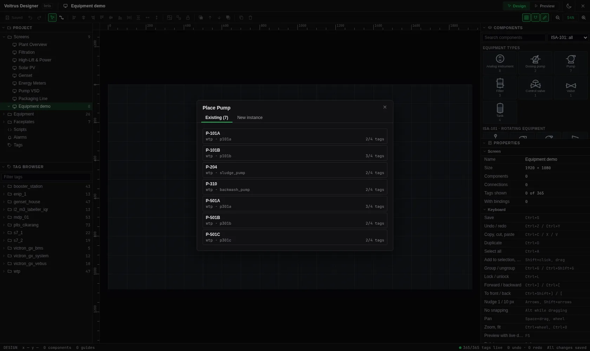

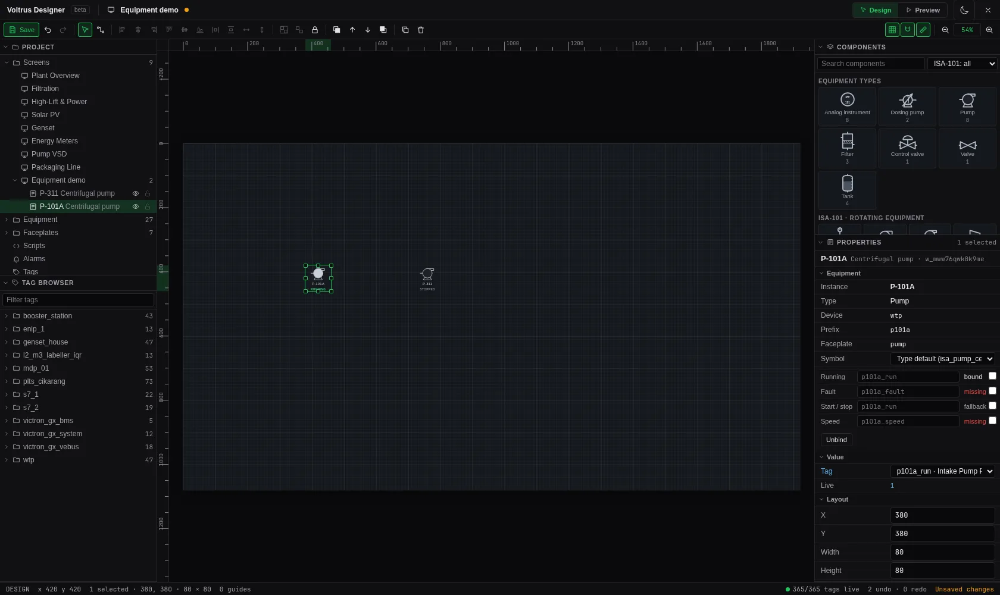
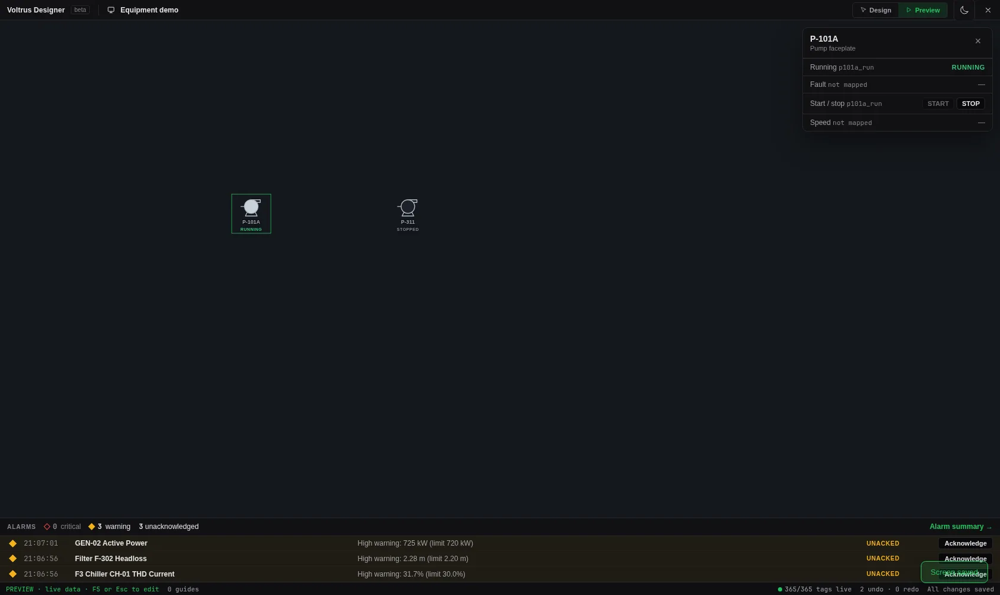
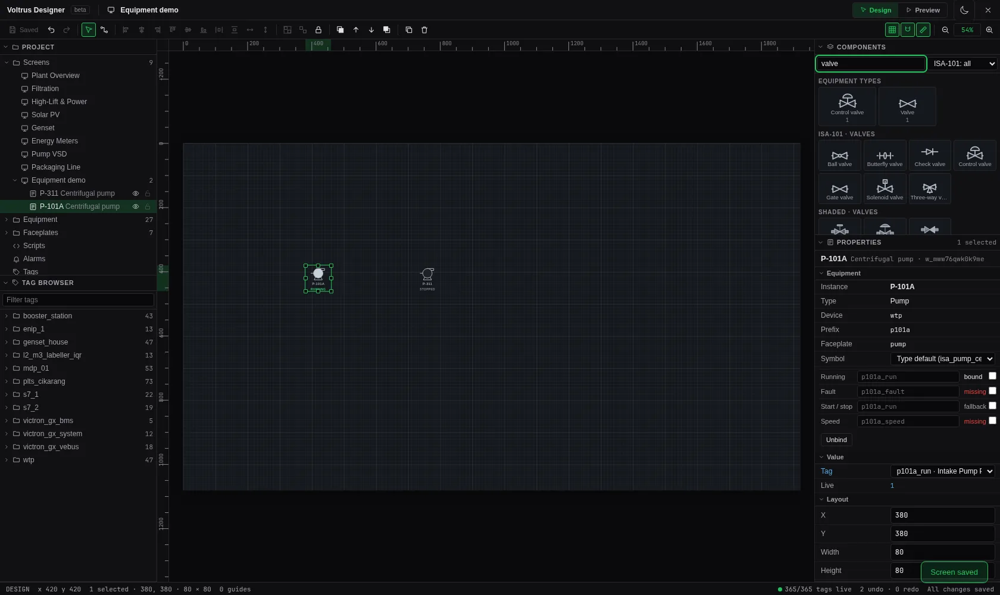
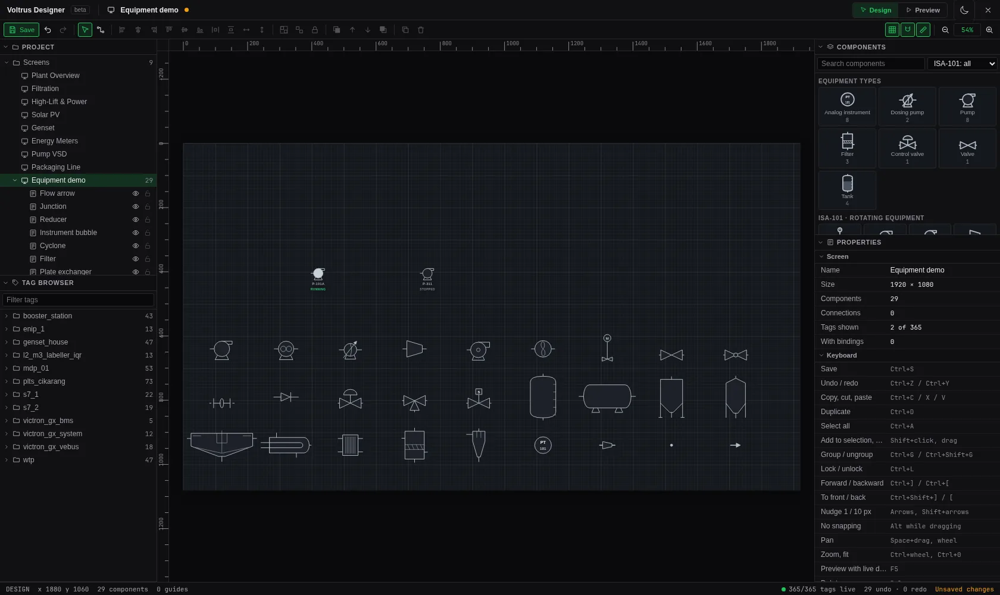

### Still open

* Lines as real polylines (`line` widget with `config.points`, snapping to
  anchors) replacing the stretched pipe symbols.
* Analog indicators from the HP-HMI guidance (moving analog indicator, deviation
  bar, sparkline).
* The console reading `symbols/*.json`.
* A type editor in the Designer (types are edited over REST, MCP or a project
  file; the Designer edits instances).

## Phase 2b: widget SDK

Custom widgets are Web Components with a JSON manifest:

```json
{
  "tag": "acme-ph-dial",
  "name": "pH dial",
  "version": "1.0.0",
  "size": [160, 160],
  "properties": {
    "title":  { "type": "string", "default": "pH" },
    "accent": { "type": "color",  "default": "#5aa9e6" }
  },
  "bindable": ["value", "quality", "unit", "limits", "alarm"],
  "writes": false
}
```

* The manifest drives the property grid (the same `PropRow`/binding editor) and
  says which live attributes the widget accepts. Voltrus' binding layer sets them
  (`el.value = 7.2; el.quality = 'good'; el.limits = {lo, hi, warn, crit}`); a
  widget never fetches, holds no token and cannot see other tags.
* Sandbox: each custom widget renders in a shadow root inside an `<iframe
  sandbox="allow-scripts">` with a CSP that blocks network (`connect-src 'none'`)
  and a `postMessage` bridge for attributes and the one allowed event
  (`write-request`, which goes through the normal command path, write policy and
  signature rules when the manifest declares `writes: true`). Same-origin script
  is not allowed.
* Storage: `widgets` table (id, version, manifest JSON, JS source, sha256,
  created_by), `GET/POST/DELETE /api/v1/widgets`, project section `widgets`. The
  JS is served from `/api/v1/widgets/{id}/{version}.js` with the stored hash as
  ETag; a widget row on a screen names `type: "custom:<id>@<version>"`.
* AI generation in the Assistant: the model proposes a manifest and source, the
  Designer renders it live in the sandbox with recorded values, the engineer
  approves, then it is saved like any other widget (propose, approve, apply, as
  the existing copilot tools do). Generated code goes through the same sandbox;
  approval is required, never automatic.

The existing add-on widget registry (`client/src/edition/widgets.ts`) stays for
first-party edition widgets; the SDK is for project widgets.

## Phase 3: version history (built)

The reference is [version-history.md](version-history.md); this section is the
design summary and what the Designer shows.

### Data model

An **object** is a widget or connection of a screen, or a project-wide
equipment type, equipment instance or faceplate. Tables:

* `design_changes`: one row per change of one object, never updated except by
  squashing: `seq`, `batch`, `screen_id` (`""` for project objects),
  `object_type`, `object_id`, `kind` (`add`/`update`/`remove`), `before` and
  `after` (row JSON), `username`, `source` (user, designer, api_key, mcp,
  copilot, flow, cli, system), `operation` (save, import, equipment,
  faceplate, revert, rollback, tag_rename, wizard), `at_ms`, `squashed`.
  `design_batches` holds each batch's note.
* `design_versions`: named snapshots of a screen's draft (`upto_seq`, rows,
  message, author) with their publish and review state.
* `scada_equipment_published`, `scada_connections_published` and
  `design_screen_state`: what operators see.

The log is written on the server: every writer (layout `PUT`s, project
import, equipment propagation, faceplates, snapshot rollback, revert, tag
renames, the FEED wizard) diffs the objects it may touch before and after its
write inside its own transaction and appends one row per change under one
batch id. REST, MCP, CLI and the Designer are logged alike, with no client
change; the audit log's line per save names the batch.

**Optimistic locking with `seq`.** A screen's head is the highest `seq`
touching it; `GET …/scada-layout` returns it as `seq` beside the phase 1
`revision`. Layout `PUT`s take `base_seq` and/or `base_revision`; a mismatch is
409 with the current head and `changes_since` (the batches after `base_seq`:
who, when, which objects), so the Designer shows who changed what before the
user picks reload or overwrite. Writers without a base keep overwriting,
logged like any batch.

**Retention.** Consecutive saves of one object by one author through one
source within 60 s become one row (first `before`, last `after`); a daily job
squashes rows older than 30 days to one per object per hour. Rows a version
points at are never merged across, and versions keep snapshots, so squashing
never breaks a restore. Both and a `keep_days` prune are site settings
(default: keep squashed history forever).

### Draft and published

`scada_equipment`/`scada_connections` stay the draft. Publishing copies a
version into the published tables. Operators read the published rows; a
screen never published falls back to the draft, so existing installations
behave as before; the site setting `publishing: false` turns the two-stage
flow off. Who writes and reads which side (details in
[version-history.md](version-history.md#draft-and-published)):

| Path | Writes | Reads |
|---|---|---|
| Designer, old editor, native console editor | draft | draft |
| REST layout `PUT`s, MCP, scripts, copilot | draft (publishing is a separate, explicit step) | draft, or published with `?published=1` |
| Roles that cannot configure (operator, viewer, read-only keys) | — | always published |
| Project import | draft; *publish* option publishes the touched screens in the same transaction (default off) | — |
| Project export | — | draft; `--published` / `?published=1` writes what operators see; each published screen carries `published_version: <name>` (never acted on by import) |
| 2D runtime | — | published, falling back to draft |

Publishing needs a configure role; with `approval: required` it files a
request that another administrator approves (four eyes). Editions that need
21 CFR Part 11 signatures get the signed action `design_publish` with
`stage` `publish`, `request` or `approve` ([edition-hooks.md](edition-hooks.md)).

### API

| Route | What |
|---|---|
| `GET /api/v1/screens/{id}/history?object=&object_type=&user=&batch=&before_seq=&limit=` | change log, newest first |
| `GET /api/v1/screens/{id}/blame` | per object: last change (who, when, batch, how many), who added it |
| `GET /api/v1/screens/{id}/design-status` | head, published version, changes since, pending requests |
| `GET/POST /api/v1/screens/{id}/versions`, `GET …/versions/{v}` | list; create `{name, message}` from the current draft; one with its rows |
| `GET /api/v1/screens/{id}/diff?from=&to=` | per object: added, removed, changed fields; both states as project YAML and rows |
| `GET /api/v1/screens/{id}/state?at=` | the rows of `draft`, `published`, `seq:<n>` or a version |
| `POST /api/v1/screens/{id}/revert` | whole screen or objects, written as new changes |
| `POST /api/v1/screens/{id}/publish`, `…/versions/{v}/approve`, `…/reject` | publish, or request and review |
| `GET /api/v1/design/history`, `POST /api/v1/design/revert` | project objects (types, instances, faceplates) |
| `GET/PUT /api/v1/settings/design-history`, `/api/v1/design/git`, `POST /api/v1/design/git/sync` | settings and git sync |

MCP: `list_changes`, `list_versions`, `create_version`, `diff_versions`,
`revert_screen`, `publish_screen` (propose, then apply; admin).

**Reverting one object** must not leave dangling connections or half groups:

* Reverting a widget to a state where it did not exist removes it and, in the
  same batch, every connection that ends on it; the response lists them.
* Reverting a connection to a state where it existed, when one of its end
  widgets no longer exists, is refused (409 `dangling_connection` naming the
  missing widgets) unless the request also restores them (`{objects: [...]}`
  reverts several objects as one batch; the Designer offers *Also restore …*).
* A restored widget whose `config.group` names a group with no other member is
  restored ungrouped; `config.z` is kept and re-normalised with the rest of the
  stacking order on the next save.
* Whole-screen revert is a snapshot restore, consistent by construction.

### Designer UI

The title bar shows the draft/published state (*Draft · 3 changes since
v12*, *Published v12*, *Not published*, *Publish pending approval*) and a
*Publish* button (*Request publish* when approval is required) with name,
message and what changes. A *History* pane: the timeline grouped by batch
(avatar, user, source, time, note), filtered by the selected object or user;
clicking a batch previews that state on the canvas read-only; *Revert this
object*, *Revert screen to here*. *Versions*: create, list with status,
*Compare* any two (or against draft or published) in a split view of the two
canvases with added (green), removed (red) and changed (amber) outlines and a
YAML diff underneath; revert to or publish a version; approve or reject
requests. The properties of a selected component show its blame. A save
conflict names who changed what since you loaded.

Code: `client/src/designer/history.tsx` (History pane, blame line),
`versions.tsx` (Versions tab, publish and review dialogs), `diffView.tsx`
(compare view), `StageView.tsx` (read-only render of a state with outlines),
`historyModel.ts` (batching, labels, revert requests, line diff; no React),
`client/src/queries/designHistory.ts`.

Screenshots (WTP showcase, taken by the smoke run):

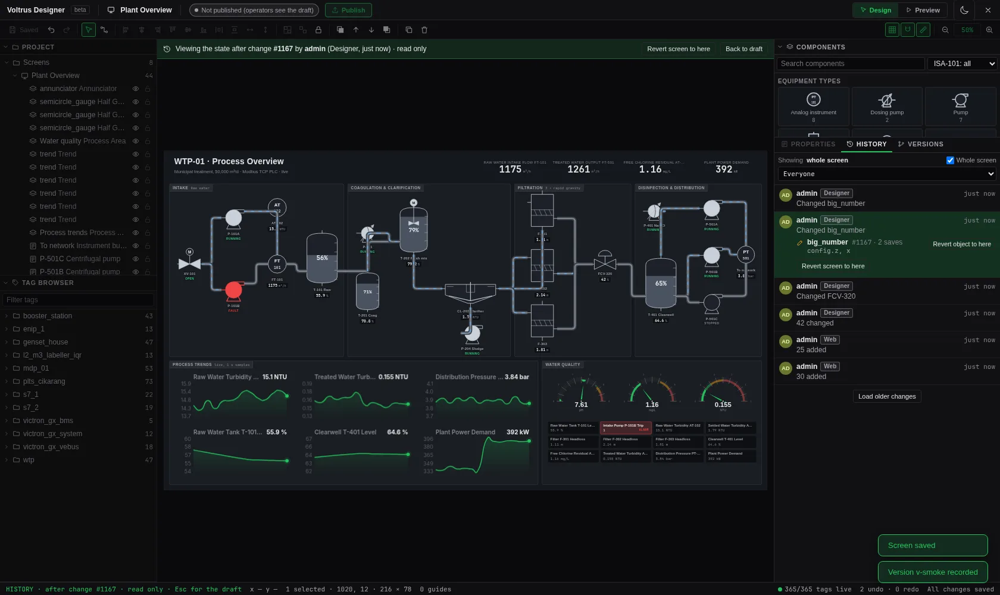
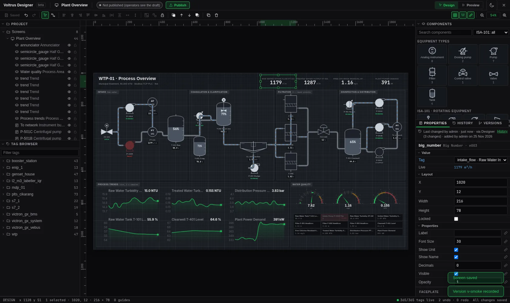
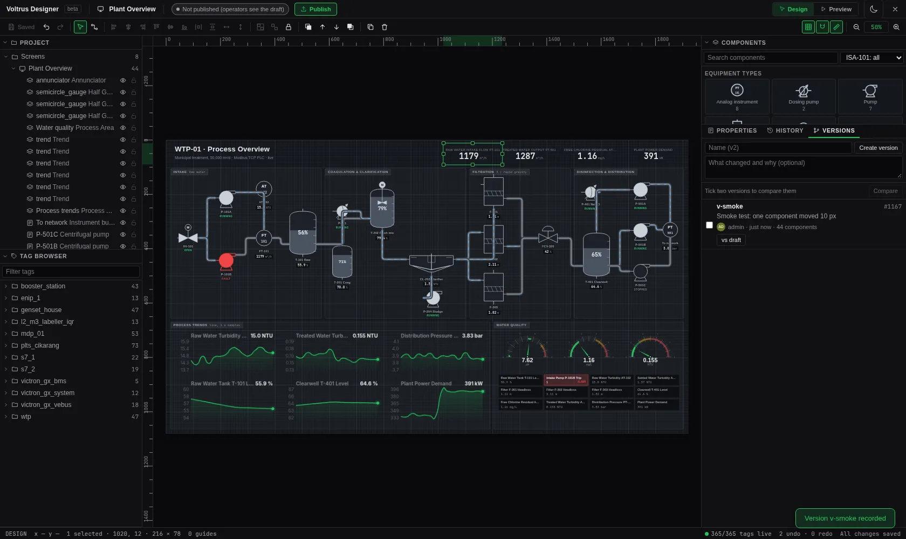
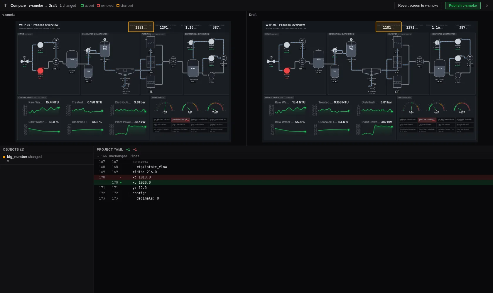
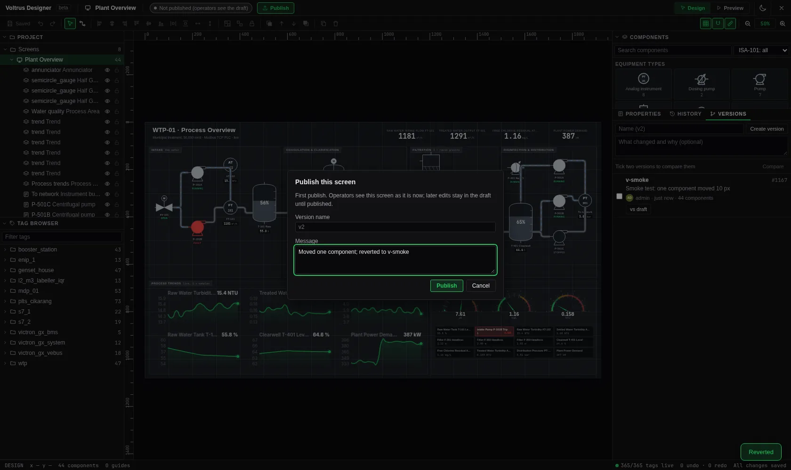
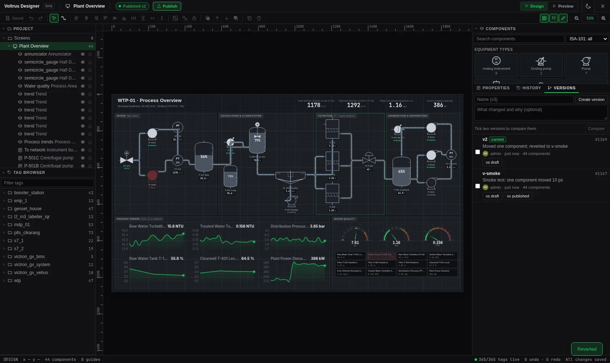
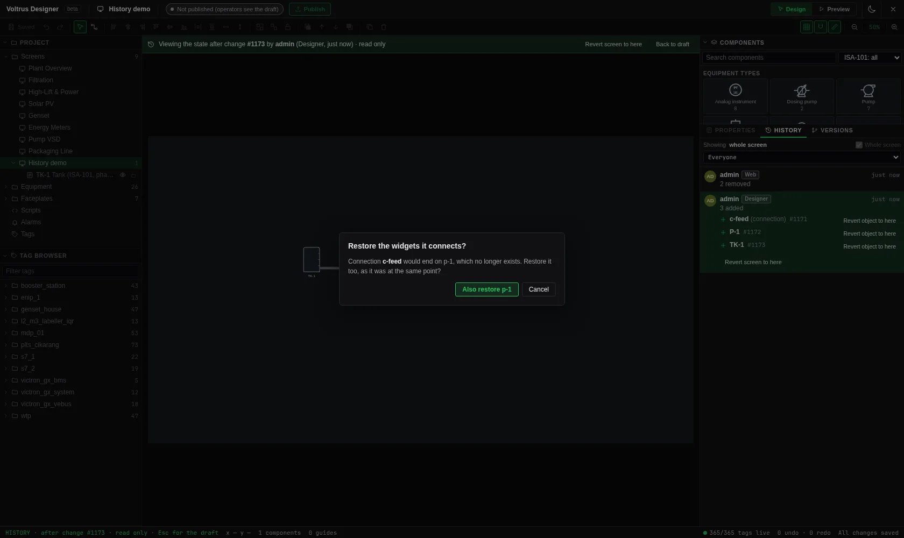

### Git sync

Optional: the published project is committed and pushed to a configured
remote (GitHub, Gitea, a bare repository) on publish or on demand, through the
`git` command line with the credential encrypted at rest. Pull is manual
through the project import plan, so a merge conflict shows as an import plan,
never as a half-written screen. No git on the operator path. See
[version-history.md](version-history.md#git-sync-optional).

### Native console

The native Designer and the console's mimic editor save through the same
routes, so their saves are logged and their conflicts are still 409s;
operators on the console get published rows by their role. Follow-ups:
the `X-Voltrus-Client` header and `base_seq` on native saves, `?published=1`
in the console's run mode, and a History pane
([version-history.md](version-history.md#native-console)).

## Phase 4: live collaboration (built)

The reference is [collaboration.md](collaboration.md); this section is the
design summary and what the Designer shows.

LAN only: the Voltrus server is the relay and the authority; nothing leaves the
site.

* **Client:** one `Y.Doc` per open screen. `Y.Map widgets` (id → `Y.Map` of the
  row's fields, with `config` as a nested `Y.Map` so two people editing different
  properties of one widget merge, and `config.bindings` a nested `Y.Map` of
  property → binding inside it, always present, so two people binding different
  properties of one widget merge too; one binding is replaced whole, last writer
  wins), `Y.Map connections`. **Z-order is defined once:** each widget's `Y.Map`
  holds a fractional index string `zi` (e.g. `V`, `VV`), and the stacking order
  is the widgets sorted by `(zi, id)`. There is no separate `Y.Array order`, so a
  concurrent reorder and delete cannot disagree. On flush the server converts the
  order to the integer `config.z` the rows have always had (0, 1, 2, …, only when
  the order changed), so REST, MCP, project files and the old editor never see
  fractional indexes; on load it derives `zi` from `config.z`. The Designer's
  `Edit` operations still run on plain documents (`model.ts`); `writeDiff`
  (`collab/ydoc.ts`) writes the difference field by field as one Yjs
  transaction, and undo uses `Y.UndoManager` scoped to the local user's origin,
  which keeps phase 1's one-edit-one-step behaviour and its coalescing.
* **Server:** `yrs` (crate `collab/`, shared with the native console) holds the
  authoritative doc per screen while anyone has it open. Sync messages ride the
  existing `/api/v1/ws` socket as MessagePack types (`DesignJoin {screen,
  protocol, epoch}`, `DesignSync {screen, data}`, `DesignAwareness {screen,
  data}`, `DesignLeave`, `DesignFlush`), so auth, the 30-second re-check and
  reconnect come for free. Joining needs the configure permission; awareness
  (presence, cursor, selection, viewport) is broadcast with the server's name and
  colour stamped on it, and never stored.
* **Persistence:** the server applies updates to the doc and, about every 2 s, on
  Ctrl+S and when the last person leaves, writes the rows through the same save
  path as REST (`write_layout_rows`: instance binding, change log). Each write is
  one `design_changes` batch per author (who last touched each object), source
  `designer`, squashed as in phase 3's retention rules, so blame and revert work
  the same for collaborative edits.
* **One lock per screen.** The open doc's writes and every other write to that
  screen (REST and MCP layout `PUT`s, revert, publish, project import) go through
  one per-screen async mutex. A REST/MCP write while a doc is open takes the
  lock, writes the session's pending edits first (so its `base_seq` is checked
  against what the editors see), writes, and applies its difference to the doc
  as a server-origin transaction, so connected editors see it and nobody
  overwrites anybody. Writers that do not take the lock (equipment propagation,
  tag renames, snapshot rollback, the FEED wizard) are merged the same way
  within half a second: the session watches the change log. With no doc open,
  writes go straight to the tables as before.
* **Validating collaborative updates.** A client is trusted with nothing it could
  not do over REST: sync messages over 256 KB, more than 50 a second, or a doc
  over 5 MB are refused (`DesignError`); awareness is capped at 4 KB. At every
  write the server checks the objects that changed (shape, numbers within the
  stage, `config` under 64 KB, binding shapes and new tag refs, tag ids,
  equipment instances, faceplates, connection ends). An object that fails is put
  back as it was last written as a server-origin transaction (every client
  converges on the valid state), the rejection goes to the audit log with its
  author, and the author's client gets `DesignRejected` (a toast names the
  objects and why).
* **Comments** pinned to objects or points, in threads with replies, resolve and
  `@mentions` (a notification): `design_comments`, REST under
  `/api/v1/screens/{id}/comments`, live over the socket, shown as pins, in a
  Comments tab and in the History pane.
* **Presence UI:** avatars in the title bar (click one to follow that person's
  view), coloured cursors with names on the canvas, other people's selections
  outlined in their colour, who edits which screen in the Project pane, a
  *Live · n editing* chip (*Offline · reconnecting* while the socket is down,
  with edits kept and merged on reconnect).
* **Fallback:** with the site setting `collaboration: false`, or a server that
  does not report it, the Designer saves whole layouts as in phases 1 and 3.
* **Native console:** joins the same session with `yrs` directly: live edits,
  presence and per-user undo ([native-designer.md](native-designer.md#live-collaboration-phase-4-yrs-natively-built)).

Code: `client/src/designer/collab/` (`fractional.ts`, `ydoc.ts`, `provider.ts`,
`undo.ts`, `useCollab.ts`, `ui.tsx`), `client/src/queries/designComments.ts`;
server `src/collab/` (sessions, flush, validation), `src/api/collab.rs`,
`src/storage/design_comments.rs`; shared `collab/` (`document.rs`,
`fractional.rs`, `wire.rs`).

Screenshots (WTP showcase, two browsers, taken by the collaboration smoke run):

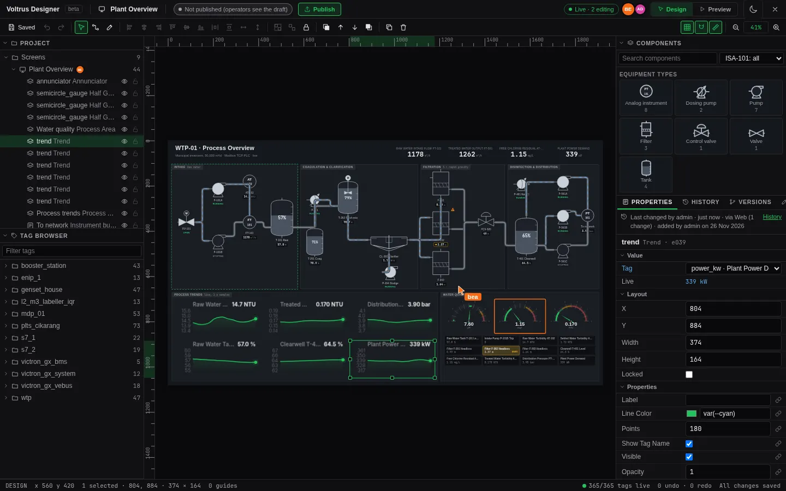
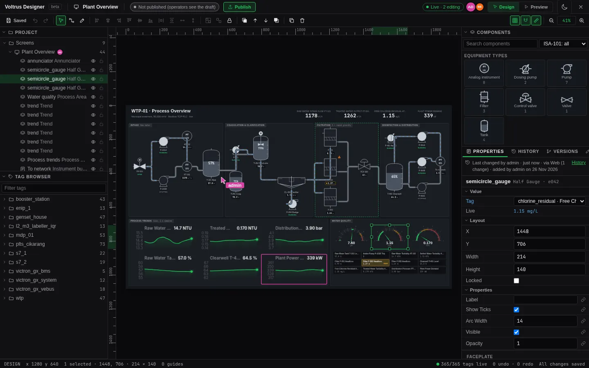
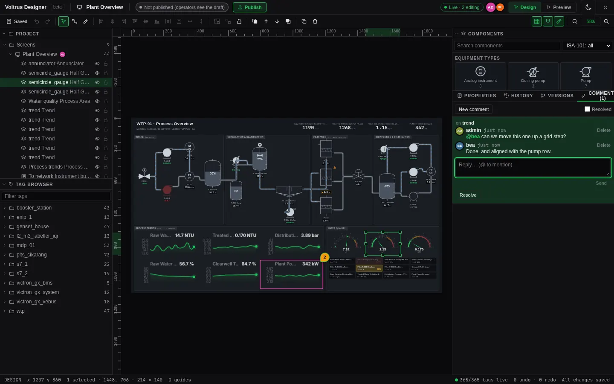
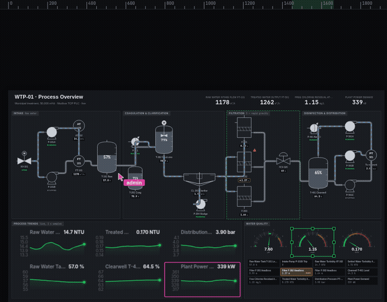

## Phase 5: mobile layouts and PWA (built)

On a phone (a window at most 640 px wide) the 2D view shows each screen as a
list built for a thumb instead of the 1920×1080 stage. Engineers do not draw it:
it is generated from the screen and adjusted in the Designer's *Mobile* pane.

### The generated layout

`client/src/scada2/mobile/operatorLayout.ts` (no React; tests in
`client/tests/operatorLayout.test.ts`):

* **Sections.** Every process area becomes a section titled with the area's
  title. A component belongs to the smallest area that holds its centre.
  Components outside any area come first, in a section with no title. Sections
  follow the areas' reading order.
* **Reading order** inside a section: top to bottom, then left to right. A
  component whose vertical centre lies within the first component of a row is on
  that row. Ties break by id, so the order is the same on every load.
* **What each component becomes:**

  | Component | On the phone |
  |---|---|
  | Equipment symbol with a tag, an equipment instance or a faceplate | a row: the symbol drawn small in its live state, label, state (Running, Stopped, Open, Fault…, plus Manual and Interlock), the value for level and value symbols; a tap opens its faceplate |
  | Gauge, big number, indicator, bar, status light and other one-value widgets with a tag | a row: label, value with unit, alarm or quality state; a tap opens the faceplate or the trend popup, as on the stage |
  | Trend, multi-pen trend, data table, bar and pie charts, annunciator, PID faceplate, add-on and custom widgets | a card with the widget drawn in it |
  | Slider, number input, toggle, push button | a card with the control |
  | Label with a binding | its text |
  | Pipes, piping symbols (junctions, arrows, connectors), unbound drawings, plain labels, connections | dropped |
  | A widget whose `visible` is fixed to false | dropped; a bound `visible` is applied live |

* **Grid.** Two columns; everything is full width unless made half width.

### Adjusting it: the Mobile pane

The Designer's right column has a *Mobile* tab. *Arrange* lists the sections and
their items as phones get them; each row has show/hide, half or full width, and
move up/down; a section has show/hide and move up/down (it moves by its area).
Plain labels are listed hidden and can be shown, as a heading. *Preview* draws
the operator view with live values in a 360×640 phone frame. *Reset* removes
every adjustment of the screen.

Each adjustment is stored on the component it concerns, in its `config`:

```json
"mobile": { "hide": true, "order": 2, "span": 1 }
```

| Key | Meaning |
|---|---|
| `hide` | `true`: not on phones. `false`: shown although the generator drops it (a plain label) |
| `order` | position in its section; on a process area, the section's position |
| `span` | `1` half width, `2` full width (the default) |

A component carries the key only while it differs from the generated layout:
showing a hidden component again, or moving items back into the generated
order, removes it. A move stores the position of every item of that section.
When the screen changes later, the generator runs again over the adjusted
components: an item without a position (one added since) is put right after the
item that precedes it in the generated order, so it lands next to its
neighbours; a deleted component takes its adjustment with it; a component moved
into another area takes its adjustment along; gaps and duplicate positions are
fine. A malformed value is ignored by the client.

**It is a property like any other.** Because the key is in the row's config, an
adjustment is one undo step, goes through the same save as any layout change
(`PUT …/scada-layout` with `base_revision`/`base_seq`, 409 on conflict), is a
change in the phase 3 change log under its component (blame and revert work),
reaches operators only when the screen is published, and travels through the
phase 4 collaboration document (config is a nested map, so one person hiding a
pump while another moves it merge). Project files carry it unchanged
(`voltrus-project/1`; `docs/project-schema.json` treats config as free JSON, so
it did not change). The native console does not draw phone layouts, but it keeps
the key when it saves a screen (`native/src/mimic/tests.rs`).

**Checked on the server.** The shape is defined once, in
`collab/src/mobile.rs`, shared by the server and the console: an object with
only `hide` (boolean), `order` (a number within ±1,000,000) and `span` (1 or 2).
A layout `PUT` that sets anything else is a 400 naming the component; a
collaborative update that does is put back field by field and its author told
(`DesignRejected`), like any other bad field; a project import reports it as a
validation error. Only an override a write changes is checked, so an old row
never blocks a save.

### The operator view

`client/src/scada2/mobile/OperatorView.tsx`, mounted by `ScadaView` in run mode
on narrow screens (`LiveOperatorView.tsx` feeds it the live store):

* Taps go through the same handlers as the stage: the same faceplate (opened as
  a sheet at the bottom of the screen, closed by tapping outside), the same
  trend popup. Faceplate commands and controls use the same command path
  (`wsWriteTagResult`, falling back to `writeTag`), so write policies,
  confirmations and electronic signatures apply unchanged. Controls get a write
  handler only with the operate permission; a viewer sees the value without
  buttons.
* Operators read the published screen, as on the stage.
* *Full screen* switches to the stage for the rest of the browser session;
  *Phone layout* switches back.
* Below the list a line says that alarm notifications on a phone come from the
  Voltrus SCADA app, with a link to **Data → Phone app** to pair it
  ([mobile.md](mobile.md)). The browser does not do Web Push.

### Live, stale and offline

A value is shown as live only while the live stream is connected, the browser is
online, and the value was read less than a minute ago. Otherwise it is drawn
muted with a dotted underline and its age (*30 min ago*), and a state text is
muted with its age beside it. Without the live stream the header chip says
*Offline* and a banner says the values are not live and when they last arrived.

While live, the view keeps a snapshot of the screen in the browser's local
storage every 15 seconds (`lastKnown.ts`): its rows, the tags it shows (name,
unit, decimals, range) and their last values with the time each was read. Five
screens per user are kept; a snapshot over 400 KB is not. Signing out deletes
them, and another user signing in on the same browser does not see them.

### PWA

* **Service worker** (`client/public/sw.js`, registered by `sw-register.ts`):
  pages are network first with the cached shell as the fallback; the built
  assets (named by content hash) are cache first, at most 300 kept; translations
  and icons are network first. `/api/` is never cached or answered by the worker.
* **Offline start.** When the installed app (or a reload) cannot reach the server
  at all, and this browser has a snapshot, it opens on the last screen seen with
  its last-known values and their age, marked offline, with *Try again* and
  *Sign in*. Nothing can be tapped or written. The offline view's code is
  fetched once after sign-in, so the worker has it.
* **Manifest per site.** Before sign-in the page links the static
  `/manifest.json`. After sign-in it links
  `GET /api/v1/site/manifest.webmanifest` (needs a session; the request carries
  the cookie): `name` is the site's name as the phone app shows it (the admin's
  *Site name on the phone*, else the licence's site name, else the white-label
  title, else "Voltrus SCADA"), `short_name` that name cut to 12 characters at a
  word, `theme_color` the white-label accent, and the white-label logo first among
  the icons (an image `data:` URL, an http(s) link or a same-origin path). The
  site name is never handed out without a sign-in.
* `/favicon-192.png` and `/favicon-512.png` (the console's app icon) now exist,
  so browsers offer to install the app.
* Guest and demo (shared) accounts work as any other: the manifest needs only a
  session, and snapshots stay in that browser.

### Screenshots

WTP showcase, taken by `scripts/smoke-mobile.sh` (phone: 390×844 at 2×).

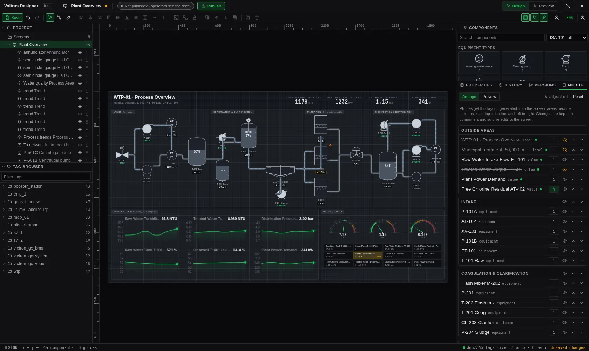
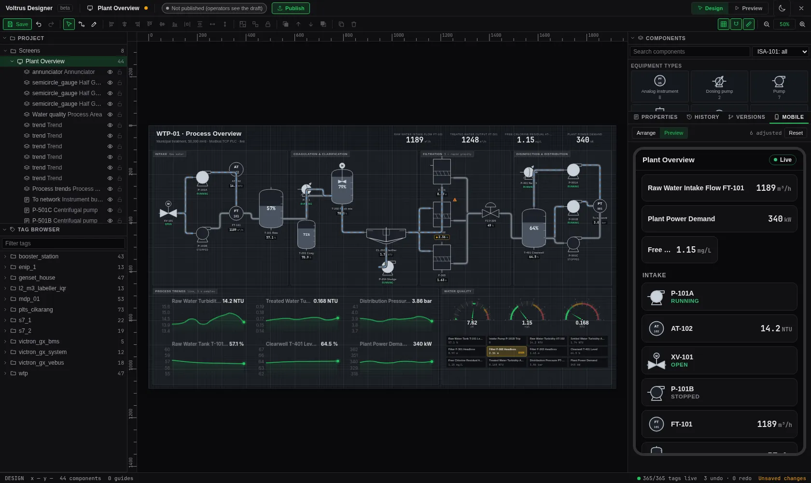
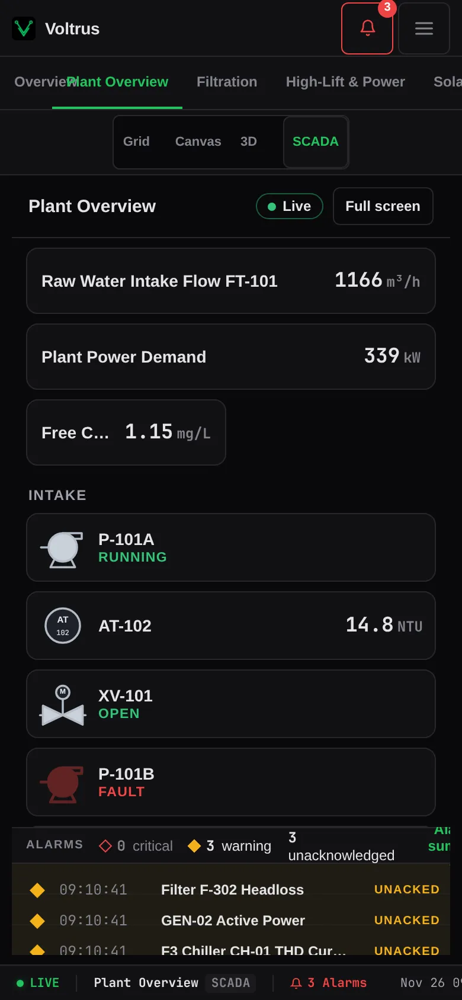
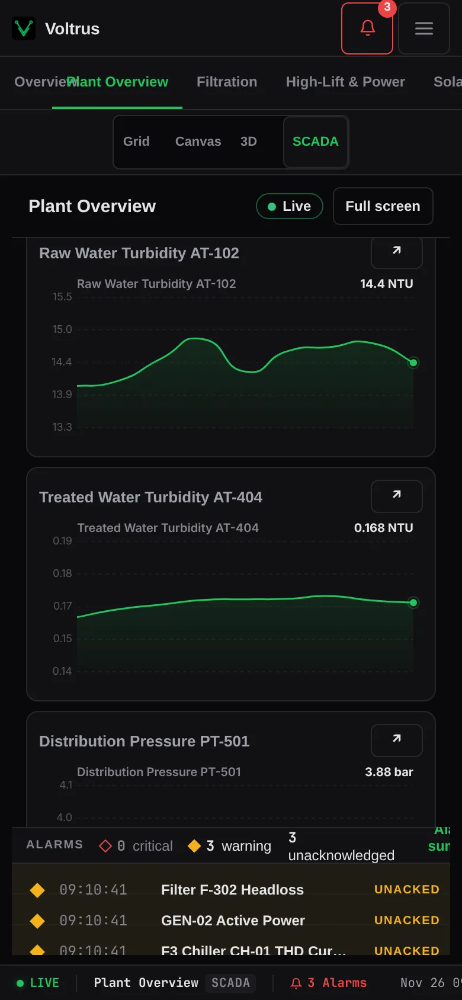
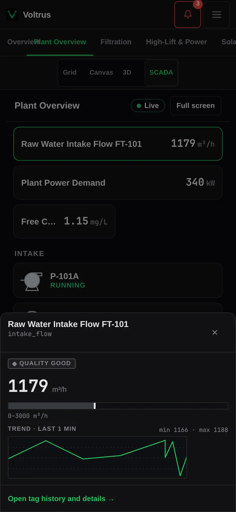
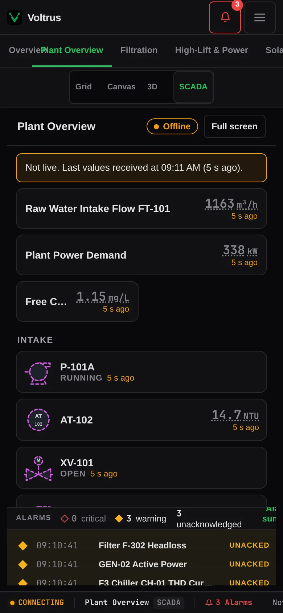
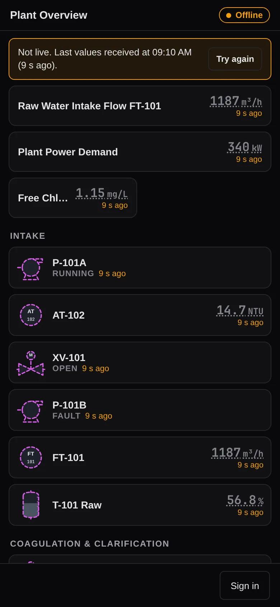

### Not in phase 5

* Drag-and-drop reordering in the pane (up/down buttons only) and moving an item
  into another section (it follows its area on the stage).
* Per-device layouts (tablet vs phone); one phone layout per screen.
* Values older than the snapshot are not back-filled with history when the
  connection returns; the live stream resumes.
* Web Push for alarms: removed in #36 in favour of the phone app.

## Migration from the scada2 editor

1. Phase 1 (this branch): Designer beside the old editor. Both read and write the
   same rows. Screens edited in the Designer open in the old editor; groups, locks
   and bindings are kept by it (they are config keys it passes through) but it
   cannot edit them.
2. When the Designer is accepted: the 2D view's **Edit** opens the Designer;
   `ScadaView` keeps run mode only (about 300 lines go: palette, inspector,
   edit toolbar, react-rnd shell). `ScadaPalette.tsx`, `ScadaInspector.tsx` (its
   field components move to `designer/`) and the edit half of `WidgetShell` are
   removed.
3. Server: refs in `config.bindings` are already portable; import validation
   rejects unknown refs and malformed bindings, export warns, and tag renames
   rewrite them (phase 1). Still open: strict validation of the layout `PUT`s
   themselves (lessons-implemented §6 left them open) should learn `group`,
   `locked`, `visible`, `opacity` and the binding shapes, with a warning (not an
   error) for an unknown ref on save, since a binding may be written before its
   tag.

## Risks

| Risk | Mitigation |
|---|---|
| Bindings evaluated only in the browser: a bound `visible` hides equipment from an operator if the expression is wrong | the binding editor shows the live result and errors before Apply; unknown tags are named; a failed evaluation keeps the fixed value; phase 3 blame shows who bound it |
| Expression cost on big screens (hundreds of bindings × 1 Hz) | parse once per text (cache), evaluation is a tree walk; widgets re-render only when their own tags change (tracked store). Measure at 1,000 bindings before phase 4 |
| Whole-set `PUT` loses a concurrent editor's work | the Designer saves both sets in one transaction with the revision it loaded; a stale save is a 409 and a Save / Overwrite / Load-theirs choice, never a silent overwrite. Writers that send no base (old editor, MCP, scripts) still overwrite: phase 3 logs it (recoverable), phase 4's per-screen lock removes it |
| Tag refs `device/key#2` for duplicate keys | the browser numbers refs exactly as the exporter does (id order, `#n`), so a ref means the same tag everywhere; a rename rewrites refs whose number shifts. Deleting one of several same-key tags still shifts the others' numbers (import validation and the editor name the now-unknown refs) |
| A bad expression or widget takes the screen down | evaluation never throws, expressions are length- and depth-limited at parse, each widget draws inside its own error boundary with its bindings |
| Yjs/yrs version skew | both pinned exactly (`yjs` 13.6.33, `yrs` 0.28.2, one `yrs` for server and console); protocol version in `DesignJoin`; the server refuses a mismatch (`DesignError protocol`) and the client asks for a reload |
| Custom widget code (SDK, AI-generated) | iframe sandbox, no network, attribute-only bridge, approval step, hash-pinned versions |
| Overlay route bypasses the app layout | it is inside the app's providers and error boundary; the app's navigation shortcuts are off while it is open; every SPA navigation with unsaved changes (Close, screen switch, Project pane links, Back) is held by a router blocker with Save / Discard / Cancel, and reload or closing the tab gets the browser prompt; `/designer` sends roles without the configure permission to the 2D view |
| Old and new editor drift | both use `layout.ts`; round-trip tests cover Designer config keys (`client/tests/designerModel.test.ts`) |

## Tests

* `client/tests/designerModel.test.ts`: undo/redo, coalescing, align, distribute,
  same size, move clamping, group/ungroup (and through save/load rows), lock,
  z-order (and through `config.z`), duplicate, primary and property binding in the
  saved row, snapping.
* `client/tests/designerBindings.test.ts`: expression grammar, missing values,
  errors, tag/expr/map bindings, `applyBindings`, refs, adversarial input
  (absurd decimals, throwing readers, malformed saved bindings, length and depth
  limits, LRU cache), escaped refs, `#n` numbering, runtime visibility.
* `client/tests/flow/designer.test.tsx` (jsdom, real router): load and save with
  the base revision, 409 → overwrite and → load theirs, save made elsewhere while
  editing, the leave guard (Close, screen switch, router navigation), keyboard
  (Ctrl+0, Ctrl+2, Ctrl+P, F5; app shortcuts off), who may open `/designer`.
* `client/tests/flow/widgetShell.test.tsx`: bound visible/opacity/label at
  runtime, a throwing binding keeps the fixed value, a throwing widget shows a
  placeholder while its neighbour draws.
* Server: `api::tests::scada_layout` (revision, 409, per-table `base_revision`,
  rename rewrites refs, export warnings), `project_yaml::binding_refs` (ref
  scanning and rewriting with escapes and string literals), bindings and
  `runSensorId` in `screen_round_trip` and the project import tests.
* `client/tests/designerEquipment.test.ts`, `tests/flow/designerEquipment.test.tsx`:
  binding patch, names, picker (existing, new with dry run, refused input),
  property section and tree; `tests/symbolLibrary.test.ts` and
  `tests/flow/symbolLibrary.test.tsx`: every symbol file valid, state styles,
  palette search, flipY ports.
* Server: `equipment_types::tests`, `api::tests::equipment_types` (CRUD, 409s,
  instantiate, propagation, materialisation on save, library), the MCP tool
  tests and the project round trip with types and instances.
* Server, phase 3: `api::tests::design_history` (log on every write path:
  layout `PUT`s, import, equipment, faceplates, rollback, tag rename; 409 with
  `changes_since`; squashing and retention; versions; diff and YAML; revert
  with dangling connections and groups; draft and published per role; the
  approval step; permissions; export `--published` and import `publish`; git
  sync to a local bare repository), `api::tests::mcp::mcp_version_history_tools`,
  `api::tests::compliance_hooks::a_screen_publish_and_its_approval_are_signed`,
  `design_git::tests`.
* Client, phase 3: `client/tests/historyModel.test.ts` (line diff, batches,
  labels, revert requests), `client/tests/flow/designerHistory.test.tsx`
  (History pane and filters, revert with *Also restore*, publish with approval
  and signature, compare with the YAML diff, runtime reads published, conflict
  names who changed what).
* `client/e2e/designer.smoke.mjs`: browser run against the WTP showcase: open,
  drag a tag in, bind an expression, undo/redo, marquee, align, group, save,
  reload and check the rows over REST, preview, light theme; then drop the Pump
  type, place the seeded P-101A and a new instance, check both show live run
  states, save and check the rows over REST, open the faceplate in preview;
  then edit, record a version, edit again, compare, revert, publish, and check
  an operator sees the published screen while the draft moves on. Needs a server, `plant-sim.py` and `playwright-core`; not
  part of `npm test`. `scripts/smoke-designer.sh <binary>` runs it end to end
  (simulator, server, seed, headless Chrome); CI runs that against the release
  binary in the embedded-UI job, with collaboration turned off (it covers the
  single-user save path).
* Phase 4: `collab` crate tests (`fractional`, `document`: rows round trip,
  field and binding merges between replicas, outside writes, `wire`),
  `api::tests::collab` (two clients converge and each change is logged under
  its author; concurrent edits of one widget, first bindings, stacking order
  with a concurrent delete; validation quarantine and the audit entry; REST
  writes, revert and publish during a session; writes outside the lock;
  permissions; limits; presence identity and removal; last leave; restart and
  reconnect epochs; comments; the setting; idle close), `collab::validate`
  tests; client `collabFractional`, `collabDoc`, `collabProvider`,
  `collabUndo`, `flow/designerCollab`; native `designer::collab` tests and
  `ws_roundtrip`. `client/e2e/collab.smoke.mjs` (`scripts/smoke-collab.sh`,
  in CI): two headless browsers as two users on one screen move, lock and
  edit at once and converge, see each other's cursors, a comment with a
  mention reaches the other, and the rows over REST hold both people's edits.
* Phase 5: `client/tests/operatorLayout.test.ts` (sections, nested areas,
  reading order, what is dropped, hide/show/span/move patches stored only when
  they differ, regeneration with added, deleted and moved components, malformed
  overrides, snapshots and ages), `client/tests/flow/designerMobile.test.tsx`
  (the pane, undo, save with the base revision, reset, preview),
  `flow/designerCollab` (adjustments through the shared document both ways,
  per-user undo), `flow/operatorView.test.tsx` (the phone view, faceplate sheet
  and its command, controls by permission, offline and stale values, the
  snapshot, the offline start, the manifest link); `voltrus-collab` `mobile`
  tests; server `collab::validate` (checked when changed),
  `api::tests::scada_layout::phone_layout_overrides_are_checked_logged_and_published`
  (400, 409 with the change named, change log, publish),
  `api::tests::collab::phone_layout_overrides_in_a_session_are_kept_and_checked`,
  `the_site_manifest_needs_a_sign_in_and_names_the_site`, the project round trip
  and import validation; native
  `mimic::tests::console_saves_keep_the_phone_layout_override`.
  `client/e2e/mobile.smoke.mjs` (`scripts/smoke-mobile.sh`, in CI): the Mobile
  pane saves `config.mobile`, an operator on a phone-sized browser gets the
  layout and a faceplate sheet, offline shows ages, and a reload offline opens
  the last-known screen from the service worker.
