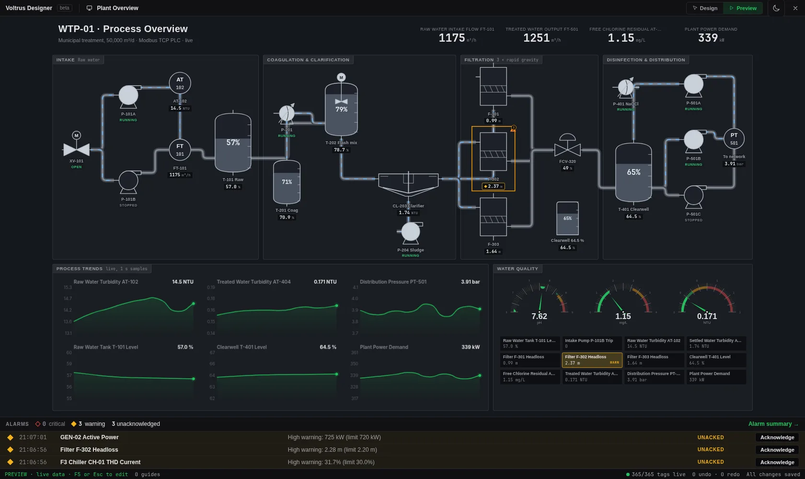
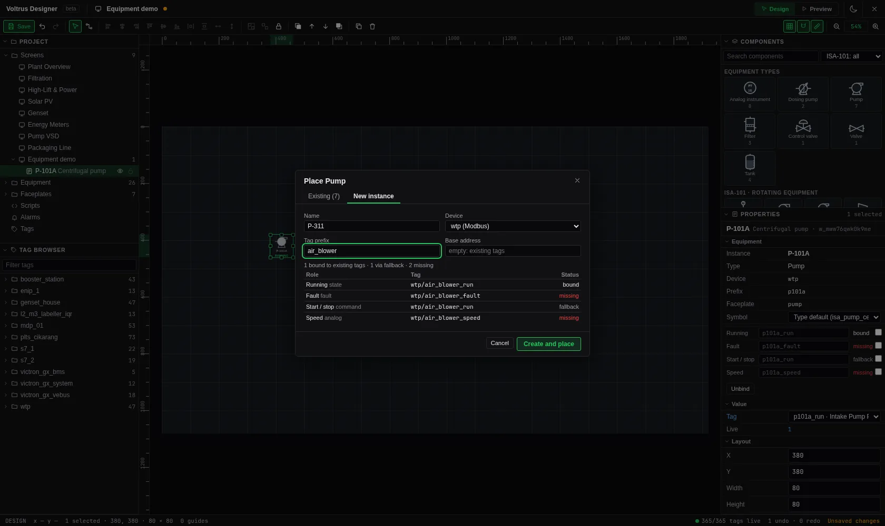

# Voltrus Designer

Design for the browser screen editor that replaces the 2D view's Edit mode:
panes, bindings, a flat ISA-101 library, version history, live collaboration,
mobile layouts and a widget SDK. Phases 1 and 2 are built; the later phases are
designs, grounded in the code as it is on `main` after #29.

Order: **1** editor, **2** symbol library and equipment types, **2b** widget SDK,
**3** version history, **4** collaboration, **5** mobile and PWA. Version history
comes before collaboration because collaboration needs its change log.

## What exists today

A 2D screen is two sets of rows per screen, read and written whole:

| Route | Rows | Storage |
|---|---|---|
| `GET`/`PUT /api/v1/screens/{id}/scada-equipment` | `{equipment_id, equipment_type, equipment_name, x, y, width, height, rotation, sensor_bindings, config}` | `scada_equipment`, replaced per screen in one transaction (`storage/settings_scada.rs`) |
| `GET`/`PUT /api/v1/screens/{id}/scada-connections` | `{connection_id, from_equipment, to_equipment, connection_type, waypoints}` | `scada_connections` |
| `GET`/`PUT /api/v1/screens/{id}/scada-layout` | both sets plus a `revision`; the `PUT` takes `base_revision` and answers 409 when the screen changed since | both tables in one transaction (added with the Designer) |
| `GET`/`POST /api/v1/faceplates`, `.../{id}` | faceplate definitions with roles | `faceplates` |

`config` and `sensor_bindings` are JSON text. The client turns rows into a
`ScadaLayoutState` (`client/src/scada2/engine/layout.ts`); stacking order travels
in `config.z`. A screen's **revision** is the SHA-256 of its equipment and
connection rows (sorted by id), computed under the same lock as writes; it is
not stored, so any writer (old editor, MCP, import) changes it. Load-then-save gives identical rows (`client/tests/scadaRoundTrip.test.ts`,
`api::tests::screen_round_trip`, `api::tests::mcp`). Projects carry screens as
`screens[].scada` with tags named by ref (`device/key`); `config.faceplateMap` is
translated id↔ref on export and import (`project_yaml/export.rs`, `import.rs`).

The editor before the Designer: `client/src/scada2/ScadaView.tsx` (run mode and
an Edit mode in one component), a palette, an inspector, react-rnd per widget,
undo/redo over whole layouts. It stays reachable (the 2D view's **Edit** button)
until the Designer is accepted.

## Phase 1: the editor (built)

Open it from the 2D view (**Designer**, admins and engineers) or at
`/designer?screen=<id>`. It is a full-window overlay of the app, so it shares the
session, live data store, theme, toasts, trend popup and signature dialog.

```
┌ title: screen · unsaved dot · Design | Preview · theme · close ───────────────┐
├ toolbar: save undo redo · select connect · align ×6 distribute ×2 same size ×2 │
│          group ungroup lock · front forward backward back · dup del ·        │
│          grid snap rulers · zoom                                             │
├──────────────┬──────────────────────────────────────────┬───────────────────┤
│ Project      │ rulers                                    │ Components        │
│  screens     │ ┌──────────────────────────────────────┐ │  ISA-101 equipment│
│   components │ │ stage 1920×1080, grid, guides,       │ │  symbols, widgets │
│  faceplates  │ │ live values, selection, handles      │ │                   │
│  scripts …   │ └──────────────────────────────────────┘ ├───────────────────┤
├──────────────┤                                          │ Properties        │
│ Tag browser  │                                          │  value tag, layout│
│ (live, drag) │                                          │  every property:  │
│              │                                          │  fixed or bound   │
├──────────────┴──────────────────────────────────────────┴───────────────────┤
│ status: mode · cursor · selection box · guides · tags live · undo depth · saved│
└────────────────────────────────────────────────────────────────────────────┘
```

Code, all under `client/src/designer/`:

| File | What |
|---|---|
| `model.ts` | the document (`ScadaLayoutState`), every edit as one undoable `Edit` (`add`, `remove`, `patch`, `order`, connection edits), history with coalescing (typing, nudging), align, distribute, same size, move, group, ungroup, lock, duplicate. No React. |
| `snap.ts` | snapping to guides, other components' edges and centres, the stage, then the grid; ruler steps |
| `expr.ts` | binding expression parser and evaluator (no `eval`) |
| `bindings.ts` | property bindings: types, evaluation, coercion, refs |
| `props.ts` | the property list of a widget (its schema + label, visible, opacity) |
| `DesignerCanvas.tsx` | stage, rulers, guides, marquee, move and resize with snap lines, drop targets, zoom and pan |
| `panes.tsx` | project browser (with the screen's component tree, visibility and lock toggles), tag browser, component palette |
| `PropertyEditor.tsx` | property grid, binding editor (tag, expression, map), faceplate section |
| `Designer.tsx` | the shell: data loading and saving, keyboard, toolbar, drop menu, preview |

**Saving** goes through the same `saveLayoutToAPI` as the old editor, so a
Designer screen is an ordinary screen for REST, MCP, the 3D twin and project
files. The Designer loads with `GET .../scada-layout` and saves both sets with one
`PUT .../scada-layout` carrying the revision it loaded (`base_revision`), in one
transaction. When someone else saved the screen in between, the server answers
409 with the current revision and writes nothing; the Designer then asks: *Load
theirs* (drops the local edits), *Overwrite with mine* (saves again based on the
revision the 409 reported, so a third save in between is still caught) or
*Cancel*. The layout query refetches on window focus; a newer revision while the
Designer has unsaved edits shows a banner (*Load theirs* / *Keep editing*)
instead of replacing the work, and without unsaved edits it just loads. Ctrl+S
with nothing to save sends nothing.

The per-table `PUT`s stay for the old editor, MCP and scripts. They take an
optional `base_revision` too (same 409) and return the new `revision`; without
it they overwrite as before. GET rows come back sorted by id.

Designer-only facts live in each row's `config`:

| Key | Meaning |
|---|---|
| `group` | group id; members of one group share it (flat groups, no nesting yet) |
| `locked` | `true`: not moved, resized, marquee-selected or deleted |
| `bindings` | property bindings, below |
| `visible`, `opacity` | common properties; at runtime a hidden widget is not drawn, nor are connections to it (the Designer shows it faded) |

**Drag-to-bind.** A tag dropped on empty stage opens a menu of what to place
(digital tags: ISA pump, valve, motor, status light, …; analog: number, value,
tank, control valve, bar, gauge, trend; a `%` or "level" tag puts the tank
first); Enter takes the first. A tag dropped on a component binds it (a table or
multi-pen trend gets one more tag). A tag dropped on a binding field inserts its
ref.

**Bindings.** Any property can be fixed or bound:

```json
"bindings": {
  "label":   { "kind": "expr", "expr": "{wtp/clearwell_level} > 90 ? \"HIGH\" : \"Clearwell \" + text({wtp/clearwell_level}, 1) + \" %\"" },
  "visible": { "kind": "tag",  "tag": "wtp/p101b_fault" },
  "fillColor": { "kind": "map", "expr": "{wtp/raw_tank_level}",
                 "cases": [{ "op": ">=", "v": 95, "out": "#f04646" }, { "op": ">=", "v": 85, "out": "#f5b21b" }],
                 "else": "#8b939e" }
}
```

Tags are named by project ref, so bindings survive export and import with no
translation. A ref is `device/key` as the project exporter numbers it: tags in id
order, the second tag with the same `device/key` is `device/key#2`, and so on
(`refsById` in `bindings.ts` mirrors `export.rs`). Inside `{...}` a backslash
escapes the next character, so a key containing `}` is written `{dev/a\}b}`; the
binding editor inserts refs escaped.

Expressions: numbers, strings, `true`/`false`/`null`, `{ref}`, `+ - * / %`,
comparisons, `&& || !`, `a ? b : c`, and `abs round floor ceil min max clamp if
bit scale text`. Semantics:

* A missing tag or value gives "no value" (the property keeps its fixed value),
  never 0. Division by zero, `scale` over an empty range and anything not a number
  also give no value.
* `==`/`!=` never convert between text and numbers: `"1" == 1` is false.
  Numbers and booleans compare as numbers (`true == 1`).
* `text(x, d)` and `round(x, d)` clamp `d` to an integer 0–20.
* `bit(x, n)` reads bit `n` (0–52) of the integer part of `x`, negatives as two's
  complement (`bit(-1, 0)` is true); another `n` gives no value.
* Limits: 2,048 characters, 1,000 parts, nesting 100 deep (a long `a+b+c+…`
  chain counts as nesting). Longer or deeper text fails to parse with a message,
  so evaluation and ref scanning never recurse unbounded.

Bindings are evaluated in the browser, in the Designer (design and preview) and
at runtime in the 2D view (`WidgetShell.useBoundInstance`, faceplate titles,
connection visibility); the server stores them and does not evaluate them.
Evaluation never throws (`evaluateBinding` catches and keeps the fixed value),
and every widget on the 2D stage and in the Designer draws inside its own error
boundary with its bindings, so one broken widget shows a placeholder and the rest
of the screen keeps running. The ref→id index is built once per tag list and
shared by all widgets; parsed expressions are kept in an LRU cache of 500
entries (oversized text is not cached). Tag-picker properties (`runSensorId`
and other `type: 'tag'` fields) hold a tag, not a value, and cannot be bound.

On the server, bindings are checked where tags are named: project import
validation rejects a binding that reads an unknown tag (or has an unknown kind,
no `tag`/`expr`, an unterminated `{`), export warns about such bindings, and
renaming a tag's key or device (`PUT /api/v1/data-sources/{id}`) rewrites every
binding ref that named it, in the same transaction, including refs whose `#n`
number shifts. Deleting a tag does not rewrite refs (there is nothing to point
them at); import validation and the editor's error list name them.
`config.runSensorId` is exported as a tag ref and resolved on import, like
`faceplateMap`.

The old editor's inspector says when a property is bound in the Designer (the
binding overrides the fixed value at runtime).

**Undo.** Every edit is one step (a drag, an align, a paste of 20 widgets, a
binding applied or removed); typing in one field and arrow nudges coalesce, but
only while they come less than a second apart, and never across different
properties. 200 steps, per screen, cleared on load. Selection is not part of
history.

**Groups.** Flat. Clicking, marquee, Ctrl+A and z-order act on whole groups:
forward/backward step past a whole neighbouring group, and a group's members
stay together in the stacking order. Deleting all but one member of a group
ungroups the last one.

**Keyboard.** Ctrl+S, Ctrl+Z / Ctrl+Y (Ctrl+Shift+Z), Ctrl+C/X/V, Ctrl+D, Ctrl+A,
Ctrl+G / Ctrl+Shift+G, Ctrl+L, Ctrl+] / Ctrl+[ (Shift: to front / back), arrows
(Shift ×10), Del, Esc, V / C (select / connect), F5 (preview; Ctrl+P stays the
browser's print), Ctrl+wheel and Ctrl+0 (zoom, fit), Space+drag or middle button
(pan), Alt while dragging (no snap), Shift on a corner handle (keep ratio), double
click (one member of a group). A drag on a process area draws a marquee (areas
are backdrops). The app's own navigation shortcuts (Mod+0 system, Mod+1…N
screens, sensor shortcuts) are off while the Designer is open.

**Leaving.** Any navigation with unsaved changes (Close, another screen in the
Project pane, its Scripts/Alarms/Tags links, Back, a link elsewhere) is held by a
router blocker that asks *Save* / *Discard* / *Cancel*; a save that hits a
conflict goes through the conflict dialog first. Reload and closing the tab get
the browser's own prompt. `/designer` needs the configure permission; other
roles opening the URL land on the 2D view of the same screen.

**Preview** runs the unsaved screen in the real runtime (`ScadaView` in run mode):
live values, alarm frames, faceplates, trend popups, operator writes with the
usual permissions and confirmations.

**Guides** are dragged out of the rulers and kept per screen in the browser
(`localStorage`), not in the screen.

Not in phase 1: nested groups, rotation handles (rotation is a property), multi
resize, copy between screens through the system clipboard, connection waypoint
editing (the old editor does not have it either), screen size other than
1920×1080, templates (UDT-like parameterised symbols).

## Phase 2: ISA-101 library and equipment types (built)

### Symbols as data

The ISA-101 library is one JSON file per symbol in `symbols/<key>.json` (format
`voltrus-symbol/1`, schema `symbols/symbol.schema.json`), as
[native-designer.md](native-designer.md) proposed: viewBox, default size, binding
kind (`state`, `level`, `value`, `none`), ports (`left`/`right`/`top`/`bottom`, the
contract connections already use) and named anchors, and layers of SVG path
strings (`d`) with a paint (`body`, `shell`, `line`, `detail`, `inner`, `solid`,
`flow`, `run`, `actuator` …). Options (`actuator`, `mounting`, `tagFunction`,
`arrow`, …) become property fields, and a layer or text can carry `if:
{option: value}`, so actuator variants are one file, not seven. Only path strings
and simple text: the console can tessellate the same strings with lyon.

38 files: centrifugal, positive displacement and dosing pumps, compressor, blower,
fan, motor, agitator; gate, ball, butterfly, check, control, three-way and
solenoid valves (actuator none, manual, diaphragm, motor, solenoid or piston on
each); vertical, horizontal and cone-bottom tanks, silo, clarifier; shell-and-tube
and plate heat exchangers; filter, cyclone; the ISA 5.1 instrument bubble (field,
panel, DCS, PLC; function letters and loop number from config); pipes with flow
arrows, junction, reducer, flow arrow, off-page connector. The eight phase-1 keys
(`isa_pump`, `isa_valve`, `isa_tank`, …) are data files too, with their old
sizes and ports, so saved screens draw as before; `isa101.tsx` is gone.

**State styles** are shared, in `symbols/_styles.json` (kept equal to
`client/src/scada2/hmi/symbolStyle.ts` by a test): grey thin outlines, running
or open filled, stopped hollow, fault red and blinking, no data magenta and
dashed. Colour is for abnormal states only. Manual mode and interlock are small
`M` and `I` boxes beside the symbol (from `config.manualSensorId` and
`config.interlockSensorId`); an alarm on the primary tag adds a priority badge
coded by shape as well as colour (1 red square, blinks; 2 amber triangle; 3
yellow diamond), so state reads in greyscale.

Every symbol rotates (`config.rotation`), mirrors (`config.flipX`, and new
`config.flipY`; ports follow both) and scales (non-scaling strokes).

**Web:** `dataSymbols.tsx` loads the files with `import.meta.glob` into the same
`SymbolDef` contract, so the old editor, the Designer, the runtime, faceplates and
ports use them unchanged. The palette (`symbolPalette.ts`) groups them by
category (Rotating equipment, Valves, Vessels, Heat transfer, Separation,
Instruments, Piping) and searches name, key, keywords and category. **Server:**
`build.rs` lists the file keys, so an equipment type naming an unknown symbol is
refused. **Native:** the console embeds the same files at build time and draws
them with lyon from the same path strings and `_styles.json`
([native-designer.md](native-designer.md#symbols)); a fixture written from the
web's `symbolFile.ts`, `symbolStyle.ts` and `symbolPalette.ts` keeps both
readings equal.

### Equipment types

A type (Pump, Valve, Tank, …) defines once the tags by role with key patterns
(`{prefix}_run`) and optional register offsets, their limits, alarms and write
policy, the faceplate, the symbol and which role drives which part of it, and
optional flows (interlocks). An instance is one line: `{name: P-101A, type: pump,
device: wtp}` (with `base: 40` it also creates the registers). Stored in
`equipment_types` and `equipment_instances`, with REST, MCP tools, the project
sections `equipment_types` and `equipment_instances` (expanded at plan time; the
dry run lists what each instance generates), and propagation: changing a type
re-applies it to every instance and re-binds every symbol of them, with a dry run
that lists the affected instances first. Seven starter types ship with the
server. All of it is in [equipment-types.md](equipment-types.md).

A symbol bound to an instance carries `config.equipment: "<name>"`. The server
fills the rest when the row is saved through any path (REST, MCP, Designer,
project import): symbol, primary tag, `faultSensorId`/`runSensorId`/…,
`faceplate` and `faceplateMap`; the type's symbol settings and the label only
where the symbol has no value of its own (a symbol's `writable: false` stays);
the symbol's other tags stay after the primary one. Binding happens in the
transaction that saves the screen, so a save from a stale revision is still
refused (409). Deleting an instance unbinds its symbols (`config.equipment`
cleared, `config.unboundEquipment` kept); they stay drawn. Rows stay ordinary rows, so the runtime, the 3D twin and the native
console need nothing new.

### In the Designer

* **Palette:** *Equipment types* above the symbols, one tile per type with its
  symbol and instance count; *Add the starter types* when there are none.
* **Drop a type** (or double-click it): the instance picker. *Existing* lists the
  type's instances (and how many are on this screen); *New instance* asks for name
  (the next free one is suggested: P-101A → P-101B), device, tag prefix (default
  from the name) and base address (Modbus only; empty binds existing tags by
  pattern). A dry run shows each role's tag and whether it is bound, created,
  a fallback or missing. *Create and place* instantiates and places the symbol,
  bound exactly as the server binds it (`resolved.widget`). Clicking it at
  runtime opens its faceplate with the instance's tags.
* **Project tree:** an *Equipment* folder, types and under them instances; an
  instance shows how many of its symbols are on this screen and selects them.
* **Properties:** a selected instance symbol shows its instance, type, device,
  prefix, faceplate and the tag per role; the instance's overrides (symbol, a
  role's tag key, skip a role) are edited there. *Preview* lists what the change
  does to existing things: tag attributes before and after (write policies
  included), registers moved, flows overwritten or deleted. A change of a write
  policy asks for the electronic signature where the edition wants one.
  *Apply to instance* saves the screen first if needed, changes the instance (every symbol of it, on every
  screen, follows) and reloads the screen. *Re-bind* when the symbol is out of
  date, *Unbind* to keep the symbol without the instance.

Code: `client/src/designer/equipment.tsx` (palette section, picker, tree,
property section), `equipmentModel.ts` (binding patch, names, no React),
`client/src/queries/equipment.ts`.

### WTP showcase

`scenarios/wtp-hmi/seed.py` installs the starter types and creates 26 instances
(pumps, dosing pumps, valves, control valve, tanks, filters, transmitters) on the
`wtp` PLC, all bound by pattern (its register map is not laid out per equipment,
so no base). The instances are created before the showcase sets its own tag
names, limits and write policies, so those win on every run. The Plant Overview, Filtration and High-Lift screens place them with
ISA-101 symbols; the clarifier, agitator, blower and discharge valves have no type
and are plain symbols. Pipe waypoints are computed from the symbol files' ports.
The vertical demo screens and the electrical single line are unchanged.

### Screenshots

WTP showcase seeded by `scenarios/wtp-hmi/seed.py`, taken by the smoke run.






### Still open

* Lines as real polylines (`line` widget with `config.points`, snapping to
  anchors) replacing the stretched pipe symbols.
* Analog indicators from the HP-HMI guidance (moving analog indicator, deviation
  bar, sparkline).
* The console reading `symbols/*.json`.
* A type editor in the Designer (types are edited over REST, MCP or a project
  file; the Designer edits instances).

## Phase 2b: widget SDK

Custom widgets are Web Components with a JSON manifest:

```json
{
  "tag": "acme-ph-dial",
  "name": "pH dial",
  "version": "1.0.0",
  "size": [160, 160],
  "properties": {
    "title":  { "type": "string", "default": "pH" },
    "accent": { "type": "color",  "default": "#5aa9e6" }
  },
  "bindable": ["value", "quality", "unit", "limits", "alarm"],
  "writes": false
}
```

* The manifest drives the property grid (the same `PropRow`/binding editor) and
  says which live attributes the widget accepts. Voltrus' binding layer sets them
  (`el.value = 7.2; el.quality = 'good'; el.limits = {lo, hi, warn, crit}`); a
  widget never fetches, holds no token and cannot see other tags.
* Sandbox: each custom widget renders in a shadow root inside an `<iframe
  sandbox="allow-scripts">` with a CSP that blocks network (`connect-src 'none'`)
  and a `postMessage` bridge for attributes and the one allowed event
  (`write-request`, which goes through the normal command path, write policy and
  signature rules when the manifest declares `writes: true`). Same-origin script
  is not allowed.
* Storage: `widgets` table (id, version, manifest JSON, JS source, sha256,
  created_by), `GET/POST/DELETE /api/v1/widgets`, project section `widgets`. The
  JS is served from `/api/v1/widgets/{id}/{version}.js` with the stored hash as
  ETag; a widget row on a screen names `type: "custom:<id>@<version>"`.
* AI generation in the Assistant: the model proposes a manifest and source, the
  Designer renders it live in the sandbox with recorded values, the engineer
  approves, then it is saved like any other widget (propose, approve, apply, as
  the existing copilot tools do). Generated code goes through the same sandbox;
  approval is required, never automatic.

The existing add-on widget registry (`client/src/edition/widgets.ts`) stays for
first-party edition widgets; the SDK is for project widgets.

## Phase 3: version history

### Data model

An **object** is a screen or a widget on a screen (later: faceplates, equipment
types, custom widgets). New tables:

```sql
-- one row per change of one object; never updated or deleted
CREATE TABLE design_changes (
  seq        INTEGER PRIMARY KEY AUTOINCREMENT,
  screen_id  TEXT NOT NULL,
  object_id  TEXT NOT NULL,        -- equipment_id, connection_id, or '' for the screen
  kind       TEXT NOT NULL,        -- 'add' | 'update' | 'remove'
  before     TEXT,                 -- row JSON before (null on add)
  after      TEXT,                 -- row JSON after (null on remove)
  user_id    INTEGER, username TEXT NOT NULL,
  at_ms      INTEGER NOT NULL,
  batch      TEXT NOT NULL         -- one save or one collaborative transaction
);
CREATE INDEX design_changes_obj ON design_changes(screen_id, object_id, seq);

CREATE TABLE design_versions (
  id         INTEGER PRIMARY KEY AUTOINCREMENT,
  screen_id  TEXT NOT NULL,
  name       TEXT NOT NULL, message TEXT NOT NULL DEFAULT '',
  upto_seq   INTEGER NOT NULL,     -- the version is the screen as of this change
  snapshot   TEXT NOT NULL,        -- rows JSON, so restore does not replay
  username   TEXT NOT NULL, at_ms INTEGER NOT NULL,
  published  INTEGER NOT NULL DEFAULT 0
);
```

The change log is written on the server: `PUT .../scada-layout` and the
per-table `PUT`s already receive whole sets, so the handler diffs the new set
against the stored one by id inside the same transaction and appends one row per
added, changed or removed object, all with one `batch` id. REST, MCP, project
import and the Designer are logged alike, with no client change. The audit log
keeps its one line per save, pointing at the batch.

**Optimistic locking moves to `seq`.** Phase 1's revision is a hash of the rows.
Once `design_changes` exists, a screen's revision is the highest `seq` touching
it (`screen_head`), and every layout `PUT` takes `base_seq` instead of (or as
well as, during the transition) `base_revision`: a mismatch is 409 with the head
and the batches since `base_seq`, so the Designer can show *who* changed *what*
before the user picks reload or overwrite. Writers without a base (old MCP
clients, scripts) keep overwriting, logged like any batch.

**Retention.** Saves from people are rare, but a phase 4 flush every 2 s while
someone drags would write thousands of rows an hour. Flush batches from the same
author on the same object within 60 s are squashed into one row (the first
`before`, the last `after`) when the next flush lands, and a nightly job squashes
unnamed batches older than 30 days to one per object per hour. Rows that a named
version's `upto_seq` points at, and published batches, are never squashed; the
snapshots in `design_versions` do not depend on the log, so squashing never
breaks a restore. Retention is a site setting (default: keep squashed history
forever, about one row per edited object per hour).

### Draft and published

`scada_equipment`/`scada_connections` stay the **draft** (what editors see and
save). Publishing copies the draft into `scada_equipment_published` /
`scada_connections_published` (same columns) and records a `design_versions` row
with `published = 1`. Operators read the published rows; a screen never published
falls back to the draft, so existing installations behave as today. A setting
per site can turn the two-stage flow off.

Who writes and reads which side:

| Path | Writes | Reads |
|---|---|---|
| Designer, old editor | draft | draft |
| REST `PUT` layout routes, MCP screen tools, the copilot's apply | draft (the copilot proposes, an engineer applies; publishing is a separate, explicit step) | draft, or published with `?published=1` |
| Project import | draft for every screen it touches; a plan option *publish after import* publishes those screens in the same transaction (default off, so an import never changes what operators see unasked) | — |
| Project export | — | **draft** (the project file is the engineering source, like a git working tree). The published state is not a second copy in the file: each screen carries `published_version: <name>` when one exists, and `export --published` writes the published rows instead, for shipping exactly what runs |
| 2D runtime, 3D twin, mobile | — | published, falling back to draft |

`*_published` tables are never exported as such and never imported: importing a
project never publishes behind the operators' back, and a restored project's
screens start unpublished-equals-draft until someone publishes.

### API

| Route | What |
|---|---|
| `GET /api/v1/screens/{id}/history?object=&before_seq=&limit=` | change log, newest first |
| `GET /api/v1/screens/{id}/blame` | per object: last change (who, when, batch) |
| `GET/POST /api/v1/screens/{id}/versions` | list; create `{name, message}` from the current draft |
| `GET /api/v1/screens/{id}/versions/{v}` | snapshot |
| `GET /api/v1/screens/{id}/diff?from=v1&to=v2\|draft` | per object: added, removed, changed fields |
| `POST /api/v1/screens/{id}/revert` | `{to: v}` whole screen, or `{object, to_seq}` one object; written as new changes, never by deleting history (rules for one object below) |
| `POST /api/v1/screens/{id}/publish` | `{name, message}`; needs the configure permission and, when the site requires it, an electronic signature (existing `signature/` flow) |
| `GET /api/v1/screens/{id}/scada-equipment?published=1` | what operators see |

MCP gets `screen_history`, `screen_diff`, `screen_publish` (admin, propose then
apply, like `project_apply_import`).

**Reverting one object** must not leave dangling connections or half groups:

* Reverting a widget to a state where it did not exist (undoing its add) removes
  it and, in the same batch, every connection that ends on it; the response lists
  them and the History pane shows them as part of the revert.
* Reverting a connection to a state where it existed, when one of its end widgets
  no longer exists, is refused (409 naming the missing widget) unless the request
  also restores that widget (`{objects: [...]}` reverts several objects as one
  batch; the UI offers *also restore P-101*).
* A restored widget whose `config.group` names a group with no other member is
  restored ungrouped; `config.z` is kept and re-normalised with the rest of the
  stacking order on the next save.
* Whole-screen revert is a snapshot restore, consistent by construction.

### Designer UI

A *History* pane (per screen and per selected object): timeline grouped by batch,
avatar and time, click to preview that state on the canvas (read-only overlay),
*Revert this object*, *Revert screen to here*. *Versions*: name + message,
*Compare* opens a split view: the two canvases side by side with added (green),
removed (red) and changed (amber) outlines, and a YAML diff of the rows in project
format (refs, not ids) underneath. The title bar shows *Draft · 3 changes since
v12* and a *Publish* button.

### Git sync (optional)

A site setting points at a local bare repo or a remote with a deploy key. On
publish, the server runs the project exporter for that screen (and anything it
references) into `screens/<id>.yaml` and commits with the version message, author
from the user. Pull is manual (*Import from git*) through the existing project
import plan, so a merge conflict shows as an import plan, never as a half-written
screen. No git on the operator path.

## Phase 4: live collaboration

LAN only: the Voltrus server is the relay and the authority; nothing leaves the
site.

* **Client:** one `Y.Doc` per open screen. `Y.Map widgets` (id → `Y.Map` of the
  row's fields, with `config` as a nested `Y.Map` so two people editing different
  properties of one widget merge, and `config.bindings` a nested `Y.Map` of
  property → binding inside it, so two people binding different properties of one
  widget merge too; one binding is replaced whole, last writer wins),
  `Y.Map connections`. **Z-order is defined once:** each widget's `Y.Map` holds a
  fractional index string `zi` (e.g. `a0`, `a0V`), and the stacking order is the
  widgets sorted by `(zi, id)`. There is no separate `Y.Array order`, so a
  concurrent reorder and delete cannot disagree. On flush the server converts the
  order to the integer `config.z` the rows have always had (0, 1, 2, …), so REST,
  MCP, project files and the old editor never see fractional indexes; on load it
  derives `zi` from `config.z`. The Designer's `Edit` operations become Yjs
  transactions; undo uses `Y.UndoManager` scoped to the local user's origin,
  which keeps phase 1's one-edit-one-step behaviour.
* **Server:** `yrs` holds the authoritative doc per screen while anyone has it
  open. Sync messages ride the existing `/api/v1/ws` socket as new MessagePack
  types (`DesignJoin {screen}`, `DesignSync {screen, update}`, `DesignAwareness
  {screen, state}`, `DesignLeave`), so auth, the 30-second re-check and
  reconnect come for free. Joining needs the configure permission; awareness
  (presence, cursor, selection, colour) is broadcast but never stored.
* **Persistence:** the server applies updates to the doc and, debounced (2 s) and
  on last leave, writes the rows through the same save path as REST. Each flush is
  one `design_changes` batch with the authors of the updates in it (squashed as in
  phase 3's retention rules), which is why phase 3 comes first: blame and revert
  work the same for collaborative edits.
* **One lock per screen.** The open doc, its flush and every other write to that
  screen (REST and MCP `PUT`s, copilot apply, project import, revert, publish) go
  through one per-screen async mutex on the server. A REST/MCP write while a doc
  is open takes the lock, diffs the incoming rows against the doc, applies the
  difference to the doc as a server-origin transaction (so connected editors see
  it and nobody overwrites anybody) and flushes immediately, all before releasing
  the lock; the `base_seq` check of phase 3 runs against the doc's flushed head.
  With no doc open, writes go straight to the tables as today.
* **Validating collaborative updates.** A client is trusted with nothing it could
  not do over REST. Per connection: updates over 256 KB, more than 50 updates a
  second, or a doc over 5 MB are refused (`DesignError`, the client reloads).
  Awareness state is capped at 4 KB and never persisted. At every flush the
  server checks the resulting rows with the same validation as a project import
  (known widget types, numeric geometry within the stage, `config` JSON within the
  row size limit, binding shapes and tag refs, connection ends that exist). An
  update that makes a row invalid is not written: the server reverts the offending
  objects to their last flushed state as a server-origin transaction (so every
  client converges on the valid state), logs the rejected update with its author
  to the audit log, and tells the author's client which objects were reverted and
  why. Joining still needs the configure permission; a session that loses it
  mid-edit is dropped by the existing 30-second re-check.
* **Comments** pinned to objects: `design_comments` (id, screen, object_id, x, y,
  body, author, resolved, at); shown as pins on the canvas and in a pane; events
  over the same socket.
* **Presence UI:** avatars in the title bar, coloured cursors with names on the
  canvas, other people's selections outlined in their colour, *Follow* a user.

## Phase 5: mobile layouts and PWA

* An operator layout is generated per screen, not drawn: components are ordered
  by area (process areas become sections), then top-to-bottom, left-to-right
  inside an area; each equipment symbol becomes a row (symbol thumbnail, label,
  state, primary value, faceplate on tap); trends and tables become full-width
  cards; decoration (lines, labels without bindings) is dropped. The generated
  layout is stored as an override list (`config.mobile = {hide, order, span}`) only
  when an engineer adjusts it in a *Mobile* preview pane, so regeneration keeps
  their changes.
* The client already registers a service worker (`sw-register.ts`); phase 5 adds a
  manifest per site, offline shell, last-known values with their age, and push for
  alarms (existing push subscriptions).

## Migration from the scada2 editor

1. Phase 1 (this branch): Designer beside the old editor. Both read and write the
   same rows. Screens edited in the Designer open in the old editor; groups, locks
   and bindings are kept by it (they are config keys it passes through) but it
   cannot edit them.
2. When the Designer is accepted: the 2D view's **Edit** opens the Designer;
   `ScadaView` keeps run mode only (about 300 lines go: palette, inspector,
   edit toolbar, react-rnd shell). `ScadaPalette.tsx`, `ScadaInspector.tsx` (its
   field components move to `designer/`) and the edit half of `WidgetShell` are
   removed.
3. Server: refs in `config.bindings` are already portable; import validation
   rejects unknown refs and malformed bindings, export warns, and tag renames
   rewrite them (phase 1). Still open: strict validation of the layout `PUT`s
   themselves (lessons-implemented §6 left them open) should learn `group`,
   `locked`, `visible`, `opacity` and the binding shapes, with a warning (not an
   error) for an unknown ref on save, since a binding may be written before its
   tag.

## Risks

| Risk | Mitigation |
|---|---|
| Bindings evaluated only in the browser: a bound `visible` hides equipment from an operator if the expression is wrong | the binding editor shows the live result and errors before Apply; unknown tags are named; a failed evaluation keeps the fixed value; phase 3 blame shows who bound it |
| Expression cost on big screens (hundreds of bindings × 1 Hz) | parse once per text (cache), evaluation is a tree walk; widgets re-render only when their own tags change (tracked store). Measure at 1,000 bindings before phase 4 |
| Whole-set `PUT` loses a concurrent editor's work | the Designer saves both sets in one transaction with the revision it loaded; a stale save is a 409 and a Save / Overwrite / Load-theirs choice, never a silent overwrite. Writers that send no base (old editor, MCP, scripts) still overwrite: phase 3 logs it (recoverable), phase 4's per-screen lock removes it |
| Tag refs `device/key#2` for duplicate keys | the browser numbers refs exactly as the exporter does (id order, `#n`), so a ref means the same tag everywhere; a rename rewrites refs whose number shifts. Deleting one of several same-key tags still shifts the others' numbers (import validation and the editor name the now-unknown refs) |
| A bad expression or widget takes the screen down | evaluation never throws, expressions are length- and depth-limited at parse, each widget draws inside its own error boundary with its bindings |
| Yjs/yrs version skew | pin both; protocol version in `DesignJoin`; server refuses mismatches with a reload prompt |
| Custom widget code (SDK, AI-generated) | iframe sandbox, no network, attribute-only bridge, approval step, hash-pinned versions |
| Overlay route bypasses the app layout | it is inside the app's providers and error boundary; the app's navigation shortcuts are off while it is open; every SPA navigation with unsaved changes (Close, screen switch, Project pane links, Back) is held by a router blocker with Save / Discard / Cancel, and reload or closing the tab gets the browser prompt; `/designer` sends roles without the configure permission to the 2D view |
| Old and new editor drift | both use `layout.ts`; round-trip tests cover Designer config keys (`client/tests/designerModel.test.ts`) |

## Tests

* `client/tests/designerModel.test.ts`: undo/redo, coalescing, align, distribute,
  same size, move clamping, group/ungroup (and through save/load rows), lock,
  z-order (and through `config.z`), duplicate, primary and property binding in the
  saved row, snapping.
* `client/tests/designerBindings.test.ts`: expression grammar, missing values,
  errors, tag/expr/map bindings, `applyBindings`, refs, adversarial input
  (absurd decimals, throwing readers, malformed saved bindings, length and depth
  limits, LRU cache), escaped refs, `#n` numbering, runtime visibility.
* `client/tests/flow/designer.test.tsx` (jsdom, real router): load and save with
  the base revision, 409 → overwrite and → load theirs, save made elsewhere while
  editing, the leave guard (Close, screen switch, router navigation), keyboard
  (Ctrl+0, Ctrl+2, Ctrl+P, F5; app shortcuts off), who may open `/designer`.
* `client/tests/flow/widgetShell.test.tsx`: bound visible/opacity/label at
  runtime, a throwing binding keeps the fixed value, a throwing widget shows a
  placeholder while its neighbour draws.
* Server: `api::tests::scada_layout` (revision, 409, per-table `base_revision`,
  rename rewrites refs, export warnings), `project_yaml::binding_refs` (ref
  scanning and rewriting with escapes and string literals), bindings and
  `runSensorId` in `screen_round_trip` and the project import tests.
* `client/tests/designerEquipment.test.ts`, `tests/flow/designerEquipment.test.tsx`:
  binding patch, names, picker (existing, new with dry run, refused input),
  property section and tree; `tests/symbolLibrary.test.ts` and
  `tests/flow/symbolLibrary.test.tsx`: every symbol file valid, state styles,
  palette search, flipY ports.
* Server: `equipment_types::tests`, `api::tests::equipment_types` (CRUD, 409s,
  instantiate, propagation, materialisation on save, library), the MCP tool
  tests and the project round trip with types and instances.
* `client/e2e/designer.smoke.mjs`: browser run against the WTP showcase: open,
  drag a tag in, bind an expression, undo/redo, marquee, align, group, save,
  reload and check the rows over REST, preview, light theme; then drop the Pump
  type, place the seeded P-101A and a new instance, check both show live run
  states, save and check the rows over REST, open the faceplate in preview. Needs a server, `plant-sim.py` and `playwright-core`; not
  part of `npm test`. `scripts/smoke-designer.sh <binary>` runs it end to end
  (simulator, server, seed, headless Chrome); CI runs that against the release
  binary in the embedded-UI job.
