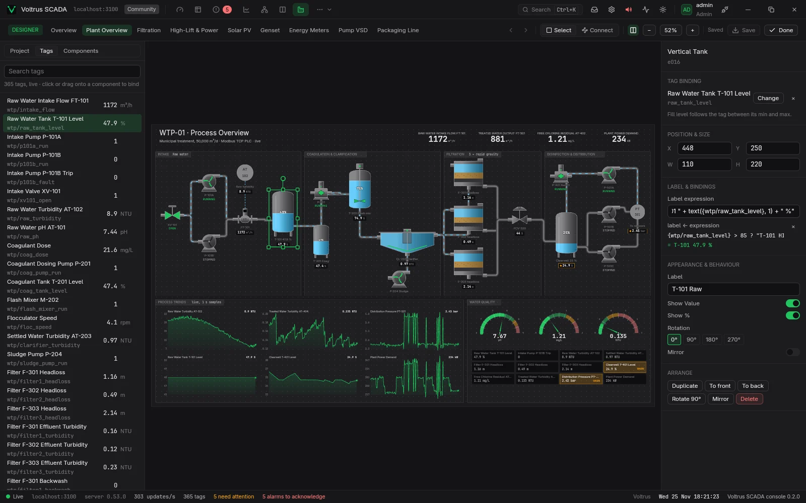
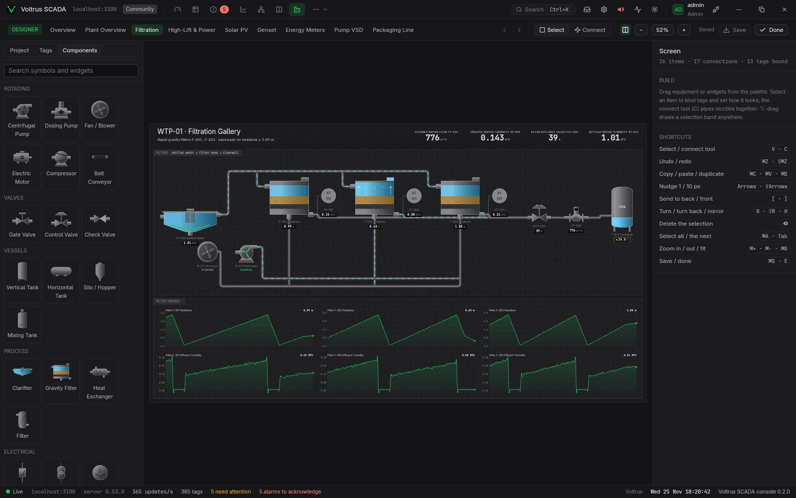
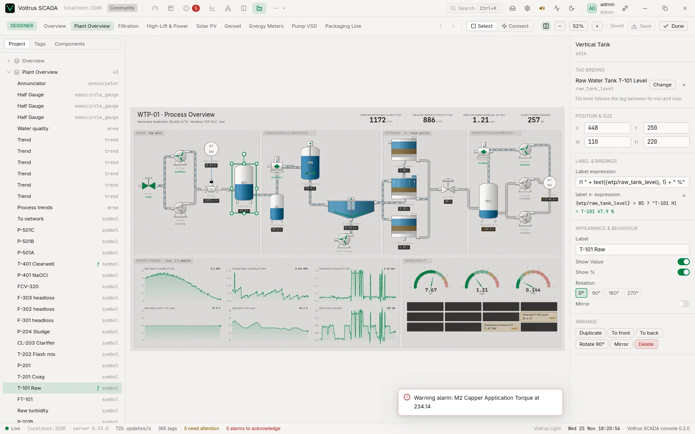

# Native Designer

The Voltrus Designer in the GPUI console (`native/`, `voltrus-native`), beside
the web Designer ([designer.md](designer.md), PR #33). Both edit the same
screens with the same rules, so an engineer can switch editors in the middle of
a job and a screen never belongs to one of them.

**Rule: one screen model, one save API, one binding language, one symbol
library.** The native Designer adds no format, no endpoint and no evaluator of
its own.

## What is shared, and how

| | Shared thing | Web | Native |
|---|---|---|---|
| Document | the 2D screen rows, `ScadaLayoutState` | `scada2/engine/layout.ts` | `mimic::Layout` (`native/src/mimic.rs`) |
| Load | `GET /screens/{id}/scada-equipment`, `/scada-connections` | `loadLayoutFromAPI` | `mimic::parse` |
| Save | the same two `PUT`s, rows named `label ‖ stored name ‖ tag name ‖ type` | `saveLayoutToAPI` | `designer::rows` / `designer::named` |
| Edits | one undoable step per edit, typing and nudges coalesced | `designer/model.ts` (`Edit`, `historyReducer`) | `mimic::edit::{Edit, History}` |
| Designer keys in `config` | `group`, `locked`, `visible`, `opacity`, `bindings` | written | read, kept on save; `visible`, `locked`, `bindings` used |
| Bindings | `config.bindings[prop] = {kind: tag|expr|map, …}`, tags by project ref `device/key` | `designer/bindings.ts` | `designer::bindings` |
| Expressions | grammar, values, errors | `designer/expr.ts` | `designer::expr` (port) |
| Symbols | `SymbolDef` keys, ports, `config.symbol` | `scada2/hmi/` (SVG) | `mimic::SYMBOLS` + `console/views/mimic/symbols.rs` (SVG path data tessellated with lyon) |
| Permissions | configure roles (admin, demo, integration) save screens | server | `Console::may_configure`, server |

The native model already existed for the mimic viewer and its editor
(`mimic.rs`, `mimic/edit.rs`): this branch makes it the Designer's and brings
it level with the web Designer's rules. What changed to match:

* **Name on save.** The web Designer keeps a stored `equipment_name` (set by
  the API, MCP or a project file) unless the label or primary tag changes;
  the console used to rename from the tag. `designer::named` follows
  `saveLayoutToAPI`, and binding the primary tag clears the stored name in the
  same undo step (`Edit::Name`, as `bindPrimaryPatch`).
* **Rotation column.** `mimic::parse` copies a row's `rotation` column into
  `config.rotation` when the config has none, as `loadLayoutFromAPI` does.
* **Bindings at runtime.** The viewer evaluates `config.bindings` before
  drawing (`designer::bound`) and skips widgets whose `visible` is false, so a
  bound screen looks the same in the browser and on the console.

**Proof, not promises.** `native/tests/fixtures/designer/web-save.mts` runs the
web Designer's own `model.ts`, `bindings.ts` and `layout.ts` (Node, no build)
over rows of the WTP showcase and writes what it saves after eight edits
(move, resize, typed label, primary tag rebind, label expression, a visibility
binding undone and redone, a state map, an undone move).
`designer::tests::the_save_matches_the_web_designer` makes the same edits with
the native model and compares every row field and every config key. The same
module runs the web's binding tests (`designerBindings.test.ts`) against the
Rust port. Regenerate the fixture whenever `model.ts`, `bindings.ts` or
`layout.ts` change; when the web Designer is on `main`, run the script in the
web test job and diff, so drift fails CI.

## The expression evaluator: one implementation

Today there are two (TypeScript and the Rust port) held together by one test
corpus. That is acceptable for phase 1 only. Target:

1. Move `native/src/designer/{expr,bindings}.rs` into a workspace crate
   `crates/voltrus-design` (no UI, no GPUI, `serde_json` only). The server
   depends on it too.
2. The server uses it where the web Designer's risks table asks for it:
   validating `config.bindings` on `PUT` and project import (unknown tags,
   parse errors as warnings on save, errors on import), and later evaluating
   bindings for headless consumers (reports, MCP `screen_render`, mobile
   layouts in phase 5).
3. The browser gets the same crate compiled to WebAssembly
   (`wasm-bindgen`, ~60 kB) behind the existing `expr.ts`/`bindings.ts`
   signatures, so `WidgetShell.useBoundInstance` does not change. `expr.ts`
   then stays only as the fallback until the WASM build is in every bundle.
4. The shared corpus becomes a JSON file of `{expr, tags, expected}` cases
   that both test suites read.

Not chosen: evaluating everything on the server and pushing results over the
WebSocket. It would make every bound property a server round trip, break the
Designer's live preview of unsaved edits, and double the WebSocket traffic of
big screens. The server validates; the clients evaluate.

## Symbols

One library, keyed by `config.symbol`. The web draws SVG components; the
console draws the same geometry from SVG path data (`symbols.rs`, lyon
tessellation, cached per size). New symbols (phase 2's ISA-101 set:
compressor, fan, conveyor, …) should be authored once as **data**: a
`symbols/<key>.json` with viewBox, SVG path strings per layer (body, fill,
state, text anchors), ports and the binding kind. The web renders it as
`<path d>`; the console tessellates the same strings. Until then a symbol
added on one side only is drawn by the other's fallback (the console's
`resolve` falls back to the pump; it should become a labelled box) and saved
unchanged.

Custom widgets (phase 2b, Web Components in a sandboxed iframe) are
web-only. The console draws them as a placeholder with their name and
primary value, and keeps their rows; the native Designer can move, resize
and bind them but not render their insides.

## Version history (phase 3)

Nothing native-specific: the change log is written by the server when the
`PUT`s arrive, so native saves are logged and blamed like any other. The
console adds the History pane later from the same routes (`/history`,
`/versions`, `/diff`, `/revert`, `/publish`); the side-by-side compare is two
`Frame`s painted by the existing mimic painter. Publishing needs the
signature flow, which the console already has (`signature.rs`).

## Live collaboration (phase 4): yrs natively

The web uses Yjs; the server holds the authoritative doc in `yrs`. The console
uses **`yrs` directly**, the same crate as the server, so:

* no JS bridge and no second CRDT implementation: the console's doc and the
  server's are the same code and the same encoding (pin one `yrs` version in
  the workspace; `DesignJoin` carries the protocol version);
* the doc layout is the one designer.md fixes (`widgets` map of `Y.Map`s with
  `config` nested, `connections`, z-order as fractional indexes in
  `config.z`), wrapped by a `designer::collab` module that maps `Edit`s to
  transactions and remote updates back to `Layout` changes;
* undo becomes `yrs::UndoManager` scoped to the local origin, which keeps
  phase 1's one-edit-one-step behaviour (the `History` API stays, its
  implementation swaps);
* sync messages ride the console's existing WebSocket (`runtime.rs`
  already reconnects and re-authenticates); presence cursors and selections
  paint on the stage canvas like the guides do today.

A real advantage of native here: a GPUI frame repaints a 2,000-widget stage
with remote cursors at display rate, where the browser's DOM stage struggles.

## Split: native-first vs web-first

| Native-first | Web-first |
|---|---|
| Large plant screens (hundreds of widgets, many screens open), smooth zoom and pan on the GPU | First-run and occasional editing: nothing to install |
| Engineering stations on the plant network, offline from the internet | Widget SDK (phase 2b): Web Components are browser-only |
| Live commissioning: design against live values next to the operator console, same session | AI-generated widgets and the Assistant's propose/approve flow |
| Collaboration performance (phase 4, `yrs` natively) | Mobile layouts and PWA preview (phase 5) |
| Keyboard-heavy layout work (align, nudge, z-order) | Faceplate editor, scripts, project import/export UI |

Both stay complete for the core: open, edit, bind, save. New *rules* land in
the shared crate first; new *panes* land where the table says, and the other
editor shows their data read-only until it catches up.

## Phase 1 native prototype (this branch)

Open it from the Mimic page (**Designer** in the bar, or E; `--page mimic
--edit` from the command line). Configure roles only: the button is not
shown to others and the save refuses them before the server would.

* Left column with three tabs: **Project** (screens; the edited one opened into
  its components, top first, with bound ƒ, hidden and locked marks; click
  selects), **Tags** (every tag with its live value and `device/key` ref,
  searched; click binds the selected component, drag onto a component binds
  it), **Components** (the symbol and widget palette).
* Stage: the existing mimic painter with live values and bindings applied,
  grid, select, rubber band, move and resize with grid and edge/centre
  snapping and guides, connect tool.
* Inspector: position and size, a label for every component, the label's
  expression with its live result or error, every other binding listed with
  its result and an unbind button, primary tag binding, the type's settings,
  arrange.
* Undo/redo (⌘Z, ⇧⌘Z), save (⌘S) with the web's naming, unsaved-changes
  prompt on leaving.

Later, in order: tag drop on empty stage opening the placement menu (web's
`dropChoices`), group/ungroup and lock editing (read today), align and
distribute, binding editor for any property (tag, expression, map) instead of
the label only, hidden widgets drawn faded in design mode, opacity, the
shared crate, the History pane.

Screenshots: the console built from this branch against the WTP showcase
(`scenarios/wtp-hmi`, server v0.53.0), T-101 and T-401 with label expressions.

