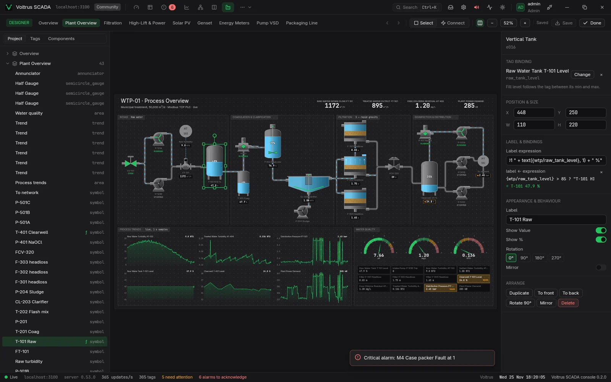
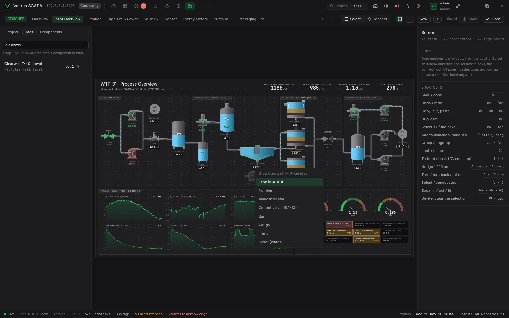
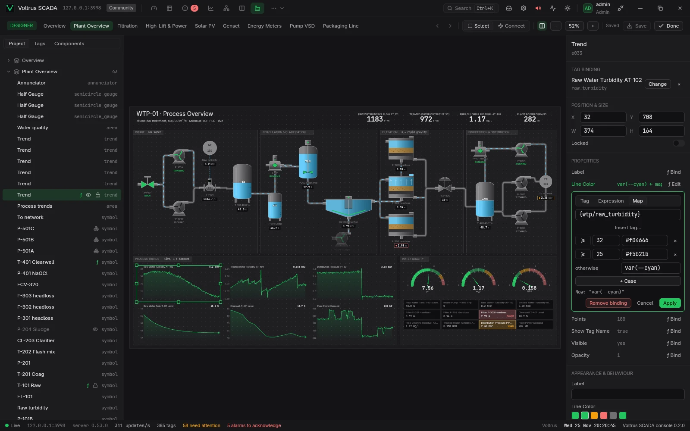
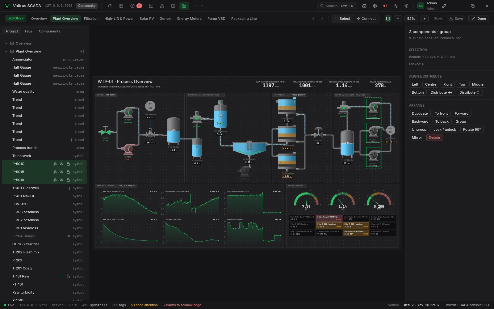
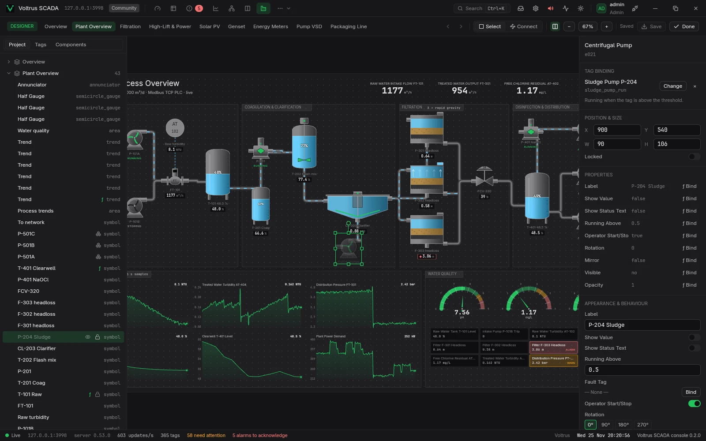
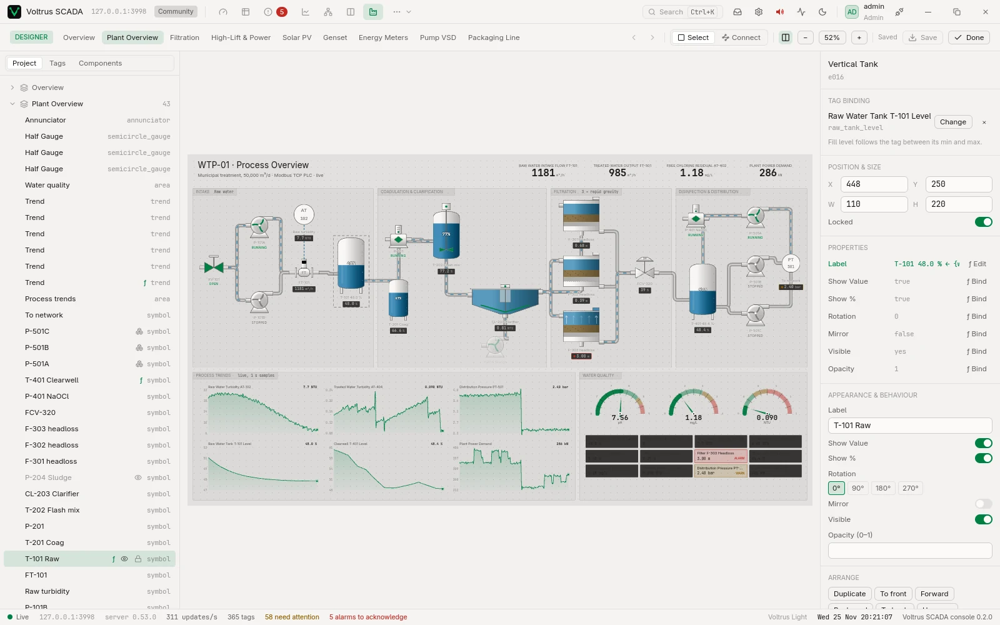
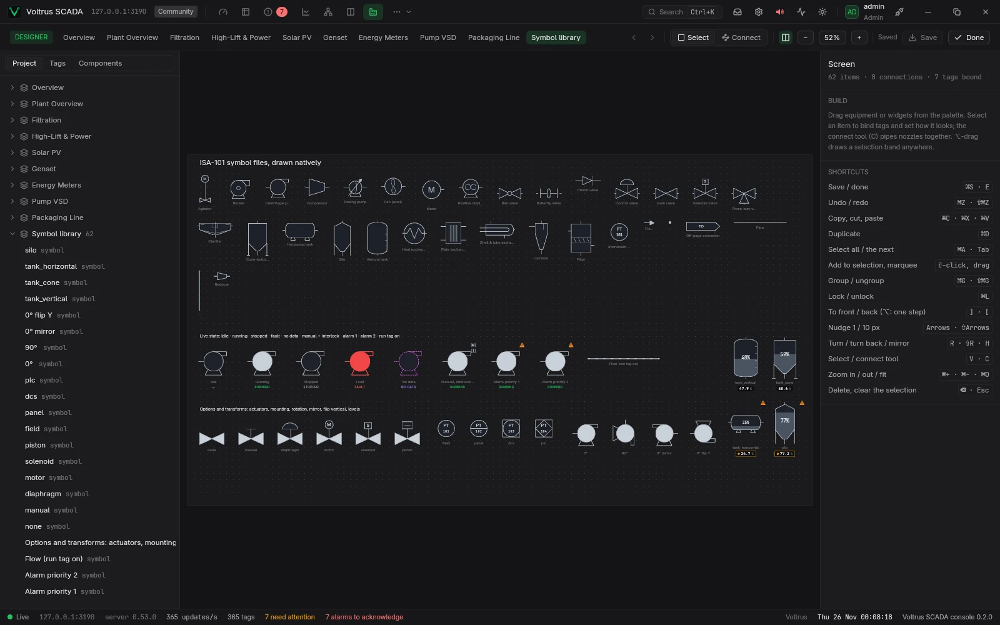
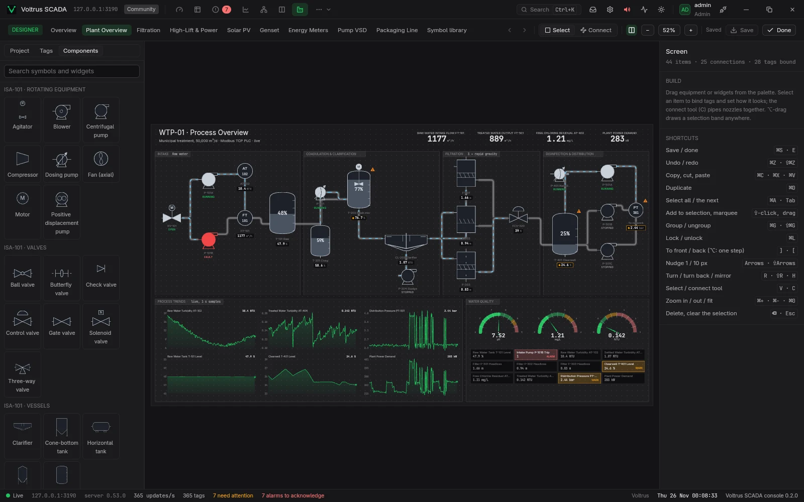
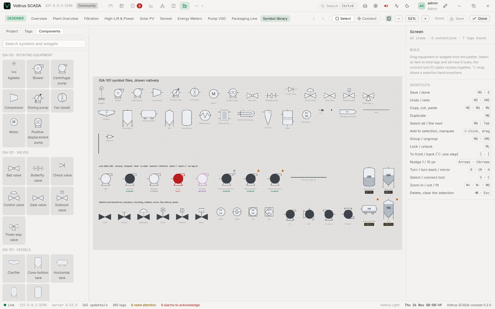

# Native Designer

The Voltrus Designer in the GPUI console (`native/`, `voltrus-native`), beside
the web Designer ([designer.md](designer.md), PR #33, on `main`). Both edit the same
screens with the same rules, so an engineer can switch editors in the middle of
a job and a screen never belongs to one of them.

**Rule: one screen model, one save API, one binding language, one symbol
library.** The native Designer adds no format, no endpoint and no evaluator of
its own.

## What is shared, and how

| | Shared thing | Web | Native |
|---|---|---|---|
| Document | the 2D screen rows, `ScadaLayoutState` | `scada2/engine/layout.ts` | `mimic::Layout` (`native/src/mimic.rs`) |
| Load | `GET /screens/{id}/scada-layout` → rows and `revision` | `loadLayoutFromAPI` | `designer::load` → `mimic::parse` |
| Save | one `PUT /screens/{id}/scada-layout` with `base_revision`; 409 with the current revision when the screen changed since; rows named `label ‖ stored name ‖ tag name ‖ type` | `saveScadaLayout`, `saveLayoutToAPI` | `designer::save`, `designer::rows` / `designer::named` |
| Edits | one undoable step per edit, typing and nudges coalesced | `designer/model.ts` (`Edit`, `historyReducer`) | `mimic::edit::{Edit, History}` |
| Arrange | group, ungroup, lock, align, distribute, marquee, restacking by unit | `model.ts` (`groupPatches`, `alignPatches`, …) | `designer::arrange` |
| Designer keys in `config` | `group`, `locked`, `visible`, `opacity`, `bindings` | written and used | written and used |
| Bindings | `config.bindings[prop] = {kind: tag|expr|map, …}`, tags by project ref `device/key` (`device/key#2` for the second tag sharing it) | `designer/bindings.ts` | `designer::bindings` |
| Expressions | grammar, values, errors, limits (2048 characters, 1000 parts, 100 levels) | `designer/expr.ts` | `designer::expr` (port) |
| Placement menu | what a tag dropped on the empty stage can become | `dropChoices` | `designer::arrange::drop_choices` |
| Symbols | `symbols/<key>.json` (`voltrus-symbol/1`) and `symbols/_styles.json`: keys, ports, view boxes, layers, options, state styles; `config.symbol` | `scada2/hmi/dataSymbols.tsx`, `symbolStyle.ts` (SVG) | `mimic::library` (embedded at build time) + `console/views/mimic/symbols.rs` (the same path data tessellated with lyon) |
| Permissions | configure roles (admin, demo, integration) save screens | server | `Console::may_configure`, server |

The native model already existed for the mimic viewer and its editor
(`mimic.rs`, `mimic/edit.rs`): this branch makes it the Designer's and brings
it level with the web Designer's rules. What changed to match:

* **Name on save.** The web Designer keeps a stored `equipment_name` (set by
  the API, MCP or a project file) unless the label or primary tag changes;
  the console used to rename from the tag. `designer::named` follows
  `saveLayoutToAPI`, and binding the primary tag clears the stored name in the
  same undo step (`Edit::Name`, as `bindPrimaryPatch`).
* **Rotation column.** `mimic::parse` copies a row's `rotation` column into
  `config.rotation` when the config has none, as `loadLayoutFromAPI` does.
* **Bindings at runtime.** The viewer evaluates `config.bindings` before
  drawing (`designer::bound`), skips widgets whose `visible` is false and
  draws `opacity`, so a bound screen looks the same in the browser and on the
  console. Tag picker properties are never bound, as on the web.
* **Saves are revision-checked.** The console loads `scada-layout` with its
  revision and saves the whole layout in one `PUT` based on it. A 409 opens
  the web's choice: *Load theirs* (the edits here are lost) or *Overwrite
  with mine* (saves again based on the revision the conflict named). A server
  from before the Designer has no `scada-layout` (404, 405, or its web page
  instead of JSON): the console then loads and saves with the two older
  routes, which still carry `base_revision` when one is known. Any other
  failure (refused, signed out, a server error, a timeout, JSON of the wrong
  shape or without a revision) is shown as an error, never taken for an older
  server, and a revision once known is never dropped. As on the web, the
  console reads the revision again when its window comes to the front: a
  clean editor takes the newer copy, one with unsaved edits shows *This screen
  was saved elsewhere* with *Load theirs* and *Keep editing*.
* **Unsaved edits outlive a lost session.** When the link fails under the
  Designer (an expired session, a server restart), its unsaved edits are kept
  in memory; after the same user signs in to the same server again, the
  Designer opens on that screen with them, still based on the revision they
  started from (so a save conflicts if the screen changed meanwhile).
* **Expression safety.** As #33's review fixes: text over 2048 characters,
  more than 1000 parts or nesting deeper than 100 fails to parse; refs escape
  `}` and `\` inside braces; `text()` and `round()` clamp decimals to 0–20;
  `bit()` takes bits 0–52 in two's complement; a result that is not a number
  gives no value; the parse cache drops the least recently used text.
  JavaScript's own rules where values cross: `toFixed` rounds the exact binary
  value (only an exact tie goes away from zero), `Math.round`, `Number()` of
  text (`0x`/`0o`/`0b`, `Infinity`, JavaScript's white space, no `inf`),
  `String()` of numbers, arrays and objects, `-0`, and error positions in
  UTF-16 units.
* **Per-frame cost.** Each widget's bindings are parsed when its config
  changes and evaluated again only when a tag they read changes
  (`designer::BoundCache`); the inspector shares one parse cache.
* **ISA-101 symbols from the shared files.** The console reads the same
  `symbols/*.json` and `symbols/_styles.json` as the web (see *Symbols*
  below), so every ISA-101 symbol of phase 2, and the placement menu's
  choices, draw with the web's geometry, state styles and colours.

**Proof, not promises.** `native/tests/fixtures/designer/web-save.mts` runs the
web Designer's own `model.ts`, `bindings.ts` and `layout.ts` (Node, no build)
over rows of the WTP showcase and writes what it saves after sixteen edits
(move, resize, typed label, primary tag rebind, label expression, a visibility
binding undone and redone, a state map, an undone move, a group, align left,
distribute vertically, a lock and an align around the locked tank, an opacity
expression, a delete that dissolves a group of one, a second group brought
forward a step, an undone centring).
`designer::tests::the_save_matches_the_web_designer` makes the same edits with
the native model and compares every row field and every config key. The same
module runs the web's binding tests (`designerBindings.test.ts`) against the
Rust port, and `expr-corpus.mts` writes what the web's `expr.ts` and
`bindings.ts` give for a few hundred expressions and bindings (malformed
ones included) and a few thousand numbers (`toFixed`, `Math.round`,
`String()`, exact ties and the doubles either side of them), which
`designer::tests::*_match_the_web_corpus` compare with the port. The
`designer-parity` job of `native.yml` runs both scripts and fails when the
fixtures they write differ from the committed ones, so a change on either
side alone fails CI. Regenerate them after such a change:

```sh
node native/tests/fixtures/designer/web-save.mts
node native/tests/fixtures/designer/expr-corpus.mts
```

The symbol library has its own fixture: `symbols.mts` runs the web's
`symbolFile.ts`, `symbolStyle.ts` and `symbolPalette.ts` over `symbols/` and
writes `symbols.json` (the keys the web loads; each symbol's view box, size,
binding, stretch, palette flag, category, ports and validation; which layers
and texts every option value shows; the state styles for each state, run tag,
mode, interlock and alarm priority; the palette's groups and searches).
`mimic::library::tests` compare the native loader with it, and check that
every file parses, validates and reads to the end of each path;
`symbols::tests::every_symbol_file_tessellates` fills and strokes every layer
and clip with the console's tessellators. The `designer-parity` job writes
`symbols.json` again with the other fixtures:

```sh
node native/tests/fixtures/designer/symbols.mts
```

## The expression evaluator: one implementation

Today there are two (TypeScript and the Rust port) held together by one test
corpus. That is acceptable for phase 1 only. Target:

1. Move `native/src/designer/{expr,bindings}.rs` into a workspace crate
   `crates/voltrus-design` (no UI, no GPUI, `serde_json` only). The server
   depends on it too.
2. The server uses it where the web Designer's risks table asks for it:
   validating `config.bindings` on `PUT` and project import (unknown tags,
   parse errors as warnings on save, errors on import), and later evaluating
   bindings for headless consumers (reports, MCP `screen_render`, mobile
   layouts in phase 5).
3. The browser gets the same crate compiled to WebAssembly
   (`wasm-bindgen`, ~60 kB) behind the existing `expr.ts`/`bindings.ts`
   signatures, so `WidgetShell.useBoundInstance` does not change. `expr.ts`
   then stays only as the fallback until the WASM build is in every bundle.
4. The shared corpus becomes a JSON file of `{expr, tags, expected}` cases
   that both test suites read.

Not chosen: evaluating everything on the server and pushing results over the
WebSocket. It would make every bound property a server round trip, break the
Designer's live preview of unsaved edits, and double the WebSocket traffic of
big screens. The server validates; the clients evaluate.

## Symbols

One library, keyed by `config.symbol`, in two parts:

* **ISA-101: the symbol files.** `symbols/<key>.json` (format
  `voltrus-symbol/1`, schema `symbols/symbol.schema.json`) and the shared
  state styles `symbols/_styles.json`, written once for both clients
  ([designer.md](designer.md), phase 2). `native/build.rs` embeds every file
  (files starting with `_` and `*.schema.json` are not symbols, as for the
  web's glob and the server's `build.rs`), so the console binary needs nothing
  beside it. `mimic::library` parses them into `SymbolDef`s (key, name,
  category, view box, size, binding, stretch, ports, palette flag) that point
  at their file, and turns `_styles.json` into the style of each live state
  (`library::style_of`, `symbolStyle`; made once for every state, run tag,
  mode, interlock and alarm priority, so drawing allocates nothing for it).
  The painter (`symbols.rs`, `data_symbol`) draws each layer whose `if` holds
  for the widget's options (missing ones take the option's default): its `d`
  tessellated with lyon (cached per path, size and style, as every library
  shape), filled and stroked by its paint role in the state's style, with the
  theme's colours from `_styles.json` (`dark`, `light`). Running is filled,
  stopped hollow, a fault red and blinking, no data magenta and dashed; flow
  layers run dashed only while the run tag is on; run layers thicken with it;
  inner strokes turn to the stage colour on a filled body. A level symbol
  fills its shells, then the level rectangle from its floor clipped to
  `level.clip`, then strokes the shells. Text comes from fixed text, an
  option (`tagFunction`, `loopNumber`, …) or `$level` (hidden when unknown or
  `showPercent` is false), drawn upright at its turned or mirrored anchor.
  Beside the drawing, top right and upright as on the web: the alarm priority
  badge (1 red square, blinking; 2 orange triangle; 3 yellow diamond), then
  the grey `M` (`config.manualSensorId` on) and `I` (`config.interlockSensorId`
  on) boxes; the console subscribes to those tags with the screen.
  `rotation`, `flipX` and `flipY` turn and mirror every symbol, and the ports
  follow both mirrors (`mimic::port_point`, as `portPoint`).
* **Shaded: drawn in code.** The older shaded library (`hmi/symbols.tsx` on
  the web) keeps its hand-drawn native port in `symbols.rs`; it has no data
  files.

The inspector lists a symbol file's options as fields (selects, switches,
text), its run tag, and for state symbols the manual mode and interlock tags,
as `fieldsOf`; *Flip Vertical* sits next to *Mirror* for every symbol. The
palette (*Components*) lists the ISA-101 categories first (`ISA-101 ·
Rotating equipment`, `ISA-101 · Valves`, …) and then the shaded ones, with the
web's search: every word must be in the name, key, category or keywords. A
symbol kept for saved screens only (`palette: false`, the phase-1 `isa_*`
keys) is not browsed, but an exact key search finds it, and saved screens and
the placement menu still draw it. An unknown key still falls back to the
pump.

Not yet native: equipment types in the palette and the placement menu
(drop a type, pick or create an instance with the dry-run preview of
`POST /api/v1/equipment-instances?dry_run=true`, place the symbol bound with
`config.equipment` from `resolved.widget`, as the web's `bindInstancePatch`).
Screens bound to instances already draw and run natively: the server writes
the binding into ordinary rows.

Custom widgets (phase 2b, Web Components in a sandboxed iframe) are
web-only. The console draws them as a placeholder with their name and
primary value, and keeps their rows; the native Designer can move, resize
and bind them but not render their insides.

## Version history (phase 3)

Nothing native-specific: the change log is written by the server when the
`PUT`s arrive, so native saves are logged and blamed like any other. The
console adds the History pane later from the same routes (`/history`,
`/versions`, `/diff`, `/revert`, `/publish`); the side-by-side compare is two
`Frame`s painted by the existing mimic painter. Publishing needs the
signature flow, which the console already has (`signature.rs`).

## Live collaboration (phase 4): yrs natively

The web uses Yjs; the server holds the authoritative doc in `yrs`. The console
uses **`yrs` directly**, the same crate as the server, so:

* no JS bridge and no second CRDT implementation: the console's doc and the
  server's are the same code and the same encoding (pin one `yrs` version in
  the workspace; `DesignJoin` carries the protocol version);
* the doc layout is the one designer.md fixes (`widgets` map of `Y.Map`s with
  `config` nested, `connections`, z-order as fractional indexes in
  `config.z`), wrapped by a `designer::collab` module that maps `Edit`s to
  transactions and remote updates back to `Layout` changes;
* undo becomes `yrs::UndoManager` scoped to the local origin, which keeps
  phase 1's one-edit-one-step behaviour (the `History` API stays, its
  implementation swaps);
* sync messages ride the console's existing WebSocket (`runtime.rs`
  already reconnects and re-authenticates); presence cursors and selections
  paint on the stage canvas like the guides do today.

A real advantage of native here: a GPUI frame repaints a 2,000-widget stage
with remote cursors at display rate, where the browser's DOM stage struggles.

## Split: native-first vs web-first

| Native-first | Web-first |
|---|---|
| Large plant screens (hundreds of widgets, many screens open), smooth zoom and pan on the GPU | First-run and occasional editing: nothing to install |
| Engineering stations on the plant network, offline from the internet | Widget SDK (phase 2b): Web Components are browser-only |
| Live commissioning: design against live values next to the operator console, same session | AI-generated widgets and the Assistant's propose/approve flow |
| Collaboration performance (phase 4, `yrs` natively) | Mobile layouts and PWA preview (phase 5) |
| Keyboard-heavy layout work (align, nudge, z-order) | Faceplate editor, scripts, project import/export UI |

Both stay complete for the core: open, edit, bind, save. New *rules* land in
the shared crate first; new *panes* land where the table says, and the other
editor shows their data read-only until it catches up.

## The native Designer (this branch)

Open it from the Mimic page (**Designer** in the bar, or E; `--page mimic
--edit` from the command line). Configure roles only: the button is not
shown to others and the save refuses them before the server would.

* Left column with three tabs: **Project** (screens; the edited one opened into
  its components, top first, with bound ƒ, group, hidden and locked marks;
  click selects; the eye and lock icons hide/show and lock/unlock),
  **Tags** (every tag with its live value and ref, searched; click binds the
  selected component, drag onto a component binds it, drag onto the empty
  stage opens the placement menu; Enter in the search binds the first match
  to the selected component, or with none selected opens the placement menu
  in the middle of the stage), **Components** (the symbol and widget
  palette).
* **Placement menu.** A tag dropped on the empty stage (or on a locked
  component, or one that shows no tag) offers what it can become, the web's
  list: for a digital tag the ISA-101 pump, valve and motor, status light,
  on/off, toggle, number; for an analog one number, value indicator, tank
  (first for a level or % tag), control valve, bar, gauge, trend, slider.
  Arrows and Enter or a click pick; Esc closes. The component lands centred
  on the drop point on the 10-pixel grid, bound to the tag (a symbol labelled
  with the tag's name and showing its status), selected, one undo step.
* **Groups and locks.** ⌘G groups the selection, ⇧⌘G ungroups, ⌘L locks or
  unlocks (unlocks when all of it is locked), also as inspector buttons and
  palette commands. A press, ⇧-click or marquee on one member takes its whole
  group; a group moves and restacks as one; locked components keep their
  place (no drag, no handles, no nudge, no align move), are skipped by the
  marquee and ⌘A, and survive ⌫ (a toast says so). Deleting all but one
  member dissolves the group; a pasted group is a new group, unlocked.
* **Align and distribute.** With two or more selected: left, centre, right,
  top, middle, bottom to the selection's box; with three or more: equal gaps
  horizontally or vertically, the outer ones staying. Each is one undo step;
  locked components stay but count for the box.
* **Properties.** Every property but a tag picker lists its value now:
  bound ones the live value and `← binding`, fixed ones the value set. ƒ
  Bind (or ƒ Edit) opens the binding editor under it: Tag (pick from the
  store), Expression (with *Insert tag…* and the function list) or Map
  (expression, cases with an operator, a number and a result, *otherwise*;
  switches for a boolean property). The preview shows `Now: <value>`, the
  errors, or that nothing is bound yet. Apply is one undo step; Remove
  binding unbinds. Visible and opacity are listed with the rest. ⌘B opens
  the editor on the selection's first bound property (or its label).
* **Hidden and opacity.** In the Designer a hidden component (fixed or
  bound) is drawn at 30% and nothing below 15%; the viewer skips hidden ones
  and draws `opacity` (0–1).
* Stage: the mimic painter with live values and bindings applied, grid,
  select, ⇧-click, marquee, move and resize with grid and edge/centre
  snapping and guides, connect tool; a selected group gets a dashed frame,
  locked components a dashed outline.
* **Keys** (as the web where the console has no other use for them): ⌘S,
  ⌘Z / ⇧⌘Z, ⌘C / ⌘X / ⌘V, ⌘D, ⌘A, ⌘G / ⇧⌘G, ⌘L, arrows and ⇧arrows,
  ⌫, Esc, ⌘+ / ⌘− / ⌘0; Tab steps through the components (a group whole),
  ⌘B edits bindings. The console keeps ] and [ for front and back
  (⌘[ and ⌘] go back and forward through pages), so forward and backward
  one step are ⌥] and ⌥[. Align and distribute are palette commands.
* **Unsaved changes.** Done, another screen, another page, back/forward,
  signing out, ⌘Q and closing the window ask first: Save, Discard, Cancel.

Later: the shared crate and the WASM build, the History pane (phase 3),
collaboration (phase 4), match size and the faceplate editor in the
inspector.

Screenshots: the console built from this branch against the WTP showcase
(`scenarios/wtp-hmi`, server from this branch); the symbol library screen is
one screen of every palette symbol and its states, made for the pictures.










